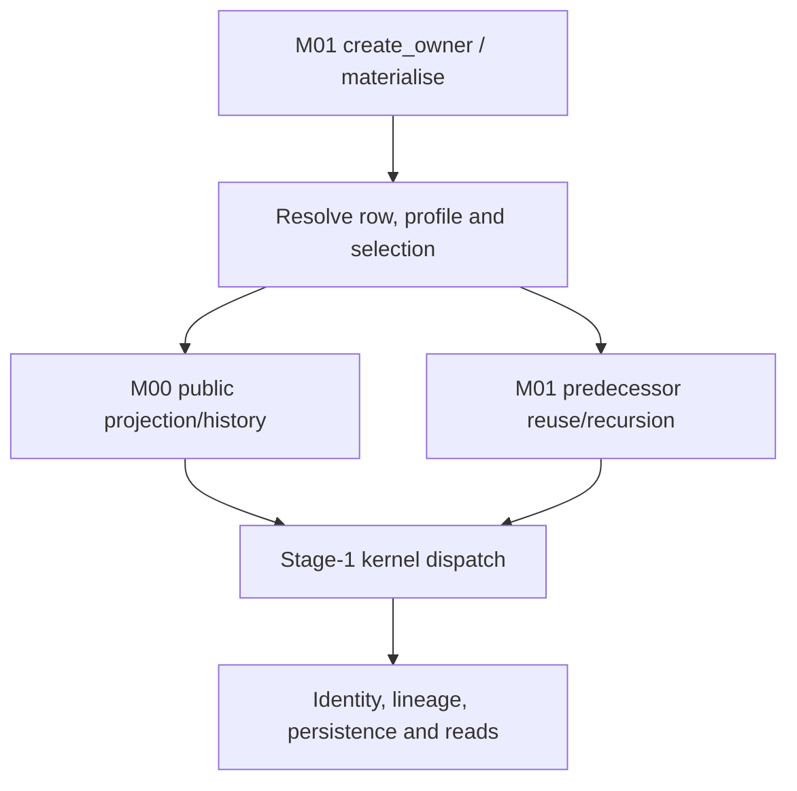

# NVDA V2 — cumulative Gates 3–4 assessment

Date: 17 October 2026 — Australia/Melbourne.

**Current result: G3.1 shared-path inspection and G3.2 original-progress documentary assessment SATISFIED. Gate3 remains IN_PROGRESS; G3.3 NOT_STARTED; Gate4 NOT_OPEN.** These are worker documentary findings, not independent implementation acceptance, production readiness or a gate-exit decision. The latest owner instruction “Okay, complete the next leaf.” authorises G3.2 only. Sections1–6 preserve the earlier G3.1 checkpoint in its historical scope; sections7–11 record this continuation.

## 1. Authority, exact baseline and recovery failure

The owner stated: “Okay, I approve the draft. Execute Leaf 3.1.” The accepted proposal is `be288c23327face2ef9c43472903c9e0d450593d:handoff/workbook_v2/gates_03_04/EXEC_PLAN_GATES_03_04_PROPOSED_20261017.md`, tree `378cce1557c544c64a208c566ef04da216abb39a`, proposal SHA-256 `5db52a2c86e370038158022fabbdba9b8fe0b8b1033b5e37b695378d5d168c89`. Activation commit `f590504a2afc3391d223ce36512d2e62f35b85e5` installs the single root plan on `work/v2-g3-1-shared-execution-assessment-20261017`, preserving the proposed snapshot and old root at `c88abc1367a6c4c755673c68e7f72536decc2c2f:EXEC_PLAN.md`. Only activation/provenance/progress metadata changes the accepted plan body. GUARDRAILS/AGENTS remain frozen. Source references below describe the unchanged production tree at be288c2.

**First failed required invariant, preserved and reported:** the workspace initially held earlier clean5e59224, not the approved draft. Recovery of `NVDA_V2_GATE_2_ACCEPTED_GATES_03_04_DRAFT_FULL_GIT_20261017.tar.gz` produced16,241,379bytes and the previously recorded SHA-256 `45cc29705bbe6453593b93b25938f1920664c7f51c9a7c85039e9252cd8e2bc0`, but extraction failed `EOFError: Compressed file ended before the end-of-stream marker was reached`. The tar stream reached member2286, inside `.git/objects/pack/pack-77586ffba536ab0d6e5cb4c3d473ac9e9714dd94.pack`. Matching that checksum does not make the archive valid. The earlier claim that this delivered archive's extraction/readback passed is contradicted by this read and is not relied on. Activation and leaf work were paused until recovery was verified.

**Verified alternative recovery, not a substitute archive PASS:**1,947 fully recovered loose Git objects were decompressed and checked against their SHA-1 object identities. They include the exact approved be288c2 commit/tree and complete later authority/assessment objects. Those verified objects were combined in a new checkout with the intact5e59224 object database, whose identically named complete pack supplies the older history. The truncated pack was excluded. Full `git fsck --full`,5e59224→be288c2 ancestry, exact approved tree and clean checkout checks passed before activation. Source/governance bytes match the intact baseline. The failed archive/partial extraction and old checkout remain preserved outside this repository. Later archived branch/ref positions were not reached in that failed stream and are not claimed restored; intact earlier refs and the new current branch are retained. No history was pruned or rewritten. The approved content and full reachable Git object graph are recovered; the failed archive itself remains failed.

## 2. What G3.1 establishes

There is an existing public construction/materialisation/read path, a M00 field/history projection seam, versioned selection and context machinery, lineage/result carriers and optional PostgreSQL persistence. These are specific source mechanisms to investigate for reuse, not a complete neutral module ready to move wholesale. The owner controller combines those mechanisms with row-specific market/candidate/policy selection and current-M01 persistence assumptions.

The path is:

The arrows describe inspected source calls, not an executed production request. Numeric/candidate equations for all209rows are deliberately reserved for G3.2. No claimed result here depends on running a fixture, importing application code or connecting a database/provider.

## 3. Shared mechanism map

Paths abbreviated below: **D/**=`src/nvda_desk/derived_signal_calculation_truth/`; **R/**=`src/nvda_desk/raw_signal_occurrence_truth/`. Line references bind to the unchanged be288c2 production files, not to historical reviewed commits.

| Mechanism and semantic responsibility | Verified source path and actual behaviour | Boundary/evidence limit |
| --- | --- | --- |
| Construction and immutable references | D/api.py:317–344,516–606,649–678,835–920,1029–1053,3075–3183. `create_owner` accepts explicit M00 reader, mappings, parameter sets, policies, conventions, contexts, persistence and clock. It rejects duplicate identity/version entries within the supplied collections and indexes them by IDs/versions. `CalculationRequestV1` carries exact raw/profile/child-policy refs. | Frozen/reference/type checks are not semantic approval of parameter values or proof that the same version's meaning remains immutable across deployments. `calculation_definition_version` is a nonempty request string; the controller does not resolve it through a separately inspected accepted-definition registry. |
| Runtime row/kernel/dependency authority | D/_catalogue.py:1–157 verifies exact runtime CSV hash67bacbcf…, ordered D001–D209, admitted kernel IDs, resolved D edges and acyclicity. `materialise`→`_materialise` at D/api.py:2317–2366 loads that row; D/_stage1.py:21–34,3713–3803 dispatches K01–K08/K16/K17. | The catalogue admits names K09–K15 but the public materialiser returns no result for rows outside its Stage1 kernel set. This is a router-level observation, not a per-row implementation census. Semantic overlays accepted in Gate2 are not automatically loaded from Markdown. |
| Raw facts remain M00-owned | D/api.py:1245–1459 calls `reader.list_projected_raw_history` using exact M00 mapping objects and receipt cutoff. R/api.py:582–668,1094–1126,1739–1807 resolves one provider/source/R mapping, traverses native field paths and returns source/native-unit/identity metadata without deriving a D. | Explicit mapping is required; a catalogue tag alone does not select a field. Mapping-declared units/source paths still need actual source-conformity evidence. No IBKR acquisition/request/callback implementation is supplied by this seam. |
| Raw history enumeration and durable M00 read | R/api.py:1808–1878 selects observations, applies receipt/event criteria and subject filter, projects and orders by receipt, sequence scope, sequence and occurrence ID, returning offset pages. M01 consumes pages of1000until cursor exhaustion. R/api.py:1403–1415 delegates raw reads to the M00 durability port when present; R/_postgres.py:530–549,566–585,686–731 owns its read-only transactions and observation queries. | M01 never needs direct M00-table access. Current durable enumeration first reads the broad raw observation range and then filters/projects in Python; each page/individual lookup can use separate reads. A stable query order is not proof of one atomic source snapshot, exact completeness of an evolving native stream or production performance. |
| Time and knowledge remain distinct | D/api.py:1054–1075 parses true-instant source timestamps/timezones. `_raw_values` uses source instant for true-instant facts and receipt basis otherwise, retaining temporal kind; D/_stage1.py:305–340 checks permissions, receipt knowledge cutoff and true-instant/derived as-of. Latest-subject freshness is applied after preserving history. | Receipt/date-only data are not silently converted into provider event time. Actual permitted temporal basis and history/window law remain row-specific; this shared filter is not a blanket no-look-ahead proof for every calculation or post-hoc mode. |
| Subjects, units and exact join identity | D/api.py:1147–1244 enforces specific option/basket minimums and exact typed selection identities;1245–1459 checks binding subjects, mapping IDs/versions/native units and applies `UnitConventionVersionV1.convert` (516–536). It has separate basket/account-scope rules and a special R284 UTC-string path. | No magnitude heuristic is used by that conversion. Native-unit/source certification and each row's selected membership still require evidence. These minimums and special cases are domain logic inside the nominally shared owner, not an entirely generic evaluator. |
| Compatible predecessor reuse and recursion | D/api.py:1460–1598 merges selected identities, refuses ambiguity and preserves typed selection.1662–1730 filters stored predecessors by definition, cutoff/as-of, required parameter/selection/context refs, raw mappings/units and convention refs.2520–2890 recursively materialises supported predecessors, or requires compatible stored history for an unsupported predecessor; missing prerequisites return no parent. | There is one M01-owned graph, not independently admitted future peer seams. A seeded stored Stage2 occurrence in a test does not establish a production Stage2 producer. History completeness has the finite retrieval limit discussed below. |
| Domain-specific child selection and provenance | D/api.py:1599–1661 exposes retained actual producer refs, unit/currency domain and raw lineage as kernel metadata.1731–2176 implements explicit proxy/basket/option/candidate/grouped child policies;2177–2316 handles event revision/identity;2317–3067 adds per-row selection/trade/official-period/regression matching. D/_financial_policy.py:58–108 validates selected producer refs/time and exact single predecessor/context. | Matching labels alone do not prove actual producer correspondence. These helpers carry financial/strategy semantics as well as measurement semantics; copying the whole controller into the foundation would also copy those responsibilities. No new proof of every financial consumer is made here. |
| Calculation/result boundary | D/_stage1.py:38–74 defines input/result carriers;296–395 selects/collects kernel inputs and wraps results;3713–3803 calls family-specific numerical functions. Its `_eval_k08` at2969–2997 delegates D175/D178/D189/D192 to `_financial_policy`. | Pure calculation helpers are separable candidates, but row mathematical correctness/support is G3.2. Kernel family or file placement does not determine foundation eligibility. Returned `None` is absence; it is not persisted as a fabricated zero or semantic NULL. Exceptions can propagate from infrastructure/validation; no guarantee that every failure becomes `None` is asserted. |
| Identity, lineage and retry | D/_stage1.py:878–901 hashes D, definition string, subject, as-of/cutoff, sorted input IDs and version keys. D/api.py:2970–3067 unions/deduplicates selected raw lineage and direct predecessor IDs, records context/convention refs, returns an existing identity or appends a new occurrence with supersession. Carrier at750–798 preserves result/time/lineage/selection. | Module owner is absent from the occurrence hash. Configuration contents are represented by IDs/versions, not embedded or hashed payload definitions. Correct cross-version namespace/immutability and future writer/consumer migration must not be inferred from deterministic hashing alone. |
| Persistence and access ownership | D/api.py:951–1013 defines the occurrence persistence/read ports and memory implementation. `create_owner` defaults to memory when persistence is absent. D/_postgres.py:1–183 encodes typed results/refs/selection;190–332 rejects same M00 schema/role and effective table/column/SET ROLE capabilities;333–527 validates each connection, stores append-only occurrence rows and exposes exact get/bounded history. | PostgreSQL is an injected technical mechanism, not calculation owner or proof of deployed durability. Adapter SQL uses M01-owned `dsct_derived_signal_occurrence_v1`; referenced parameter/context definitions are supplied separately to owner construction. Actual roles, populated stores, consumers, privileges, recovery and full runtime behaviour were not observed. |
| External effects and composition | D/api.py exposes construction, `materialise` and reads; kernels return values and the persistence boundary writes occurrences. `modules.yaml` registers only active M00 and bootstrap/inactive/non-composable M01 with M00 as permitted dependency; `implementation_allocations.yaml` has M00/M01. | Calculated action-like values do not grant order/account authority. No M02 or downstream owner is admitted by this map. The absence of a broker command on this seam does not certify every runtime/environment outside the inspected scope. |

## 4. Material shared-boundary findings to carry forward

These are source findings and bounded limitations, not a new collection of owner-approval receipts. No code/test change is made. They are linked here once so G3.2 can reference the shared proposition and G3.3 can decide reuse by component.

| ID | Required proposition versus actual inspected source | Consequence and receiving work |
| --- | --- | --- |
| SM-01 — Separate generic mechanics from domain ownership | AK-OWN/DEP/SEAM and the accepted future design require bounded responsibilities and no downstream peer runtime dependence. Actual D/api.py combines graph/persistence mechanics with hard-coded option, proxy/basket, event, candidate, account-risk and grouped-join branches; `_financial_policy` owns financial-policy consumers. | **Verified separation requirement**, not evidence that the current monolithic M01 is itself unlawful under its old remit. G3.3 assesses reusable neutral pieces; G4.1 designs local peer chains. No whole-controller reuse or shared strategy layer is justified. |
| SM-02 — Runtime authority incorporation is separate from accepted meaning | Accepted D028/D117/L2 overlays govern meaning. Actual `_catalogue.py` loads only the unchanged hash-bound CSV, and `_materialise` uses its raw/D lists. No overlay-loader path appears in the traced public controller. | **Verified incorporation gap at the shared routing boundary.** G3.2 must compare each affected actual row path to its accepted amendment; later authorised work synchronises catalogue/hash/code/proof. Do not request the same mathematical approvals again or repair files during this leaf. |
| SM-03 — Preserve version definitions and historical reproducibility | Brief §§6,10,12–14 require exact immutable versions/provenance. Actual owner maps definitions in memory; occurrence/SQL encode references, while `_compatible_history` and hashing compare IDs/versions. | **Verified storage/construction shape; external definition lifecycle UNKNOWN.** G3.2 checks actual profile use; G3.3/G4.2 identify lawful definition retention/resolution and namespace guarantees before reuse/migration. Do not infer that a new configuration database is required, or that a source ID proves its contents never changed. |
| SM-04 — Treat historical retrieval limits as real limits | Brief §§8/13 make full authorised history necessary. `_compatible_history` and supersession lookup ask for at most100,000rows; both memory and PostgreSQL `list_occurrences` sort ascending and take the first limit, with no cursor on that port. | **Verified finite-history limitation**, not an observed missing live window. Beyond that population, the shared path cannot be assumed to examine all/latest eligible history; false refusal/latest-supersession scope requires row-specific assessment. G3.2 establishes exposure; G3.3 plans any necessary bounded selection/pagination proof. No arbitrary new horizon is invented. |
| SM-05 — Durable/atomic operation is not the default or a whole graph transaction | `create_owner` defaults to memory. The PostgreSQL adapter opens operation-level connections; recursion may persist predecessors before a parent later refuses. Native-read pagination and occurrence writes do not share one graph-wide transaction in this controller. | **Verified architecture, not a finding that graph-wide atomicity is required by authority.** Retain valid independent predecessors; distinguish sequential retry from concurrency/crash proof and a consistent input set from database snapshot assumptions. G3.3/G4.2 specify actual required durability/transaction/compatibility and independent evidence. Actual deployed persistence remains UNKNOWN. |
| SM-06 — Future owner identities cannot silently inherit old stored truth | Occurrence hash has no module owner; current store/carrier/role checks are M01-oriented and compare full contents for identity conflict. There is no admitted successor in current registry. | **Verified compatibility constraint; actual existing data/consumers UNKNOWN.** Preserve historical writer attribution and exact version identity. G3.3/G4.2 must resolve reader/writer/schema/identity compatibility, cutover/recovery and separate retirement before treating old occurrences as successor-owned. No stored result is relabelled here. |

Each finding states a present source fact and a separate consequence. It does not use a missing test run as proof of a defect. Controlled history fixtures, construction-time type checks or a parameter name do not discharge actual source/profile sufficiency.

## 5. Evidence actually examined and its limits

**Normative reading:** active approved plan and master-derived scope; original calculation brief §§6–18/AppendixA; current module/allocation registry; ownership/state, dependency, public-seam and test/promotion laws; accepted Gate2 authority/exit records and their source-versus-instance distinction. Shared production inspection covered D/_catalogue.py in full, D/api.py construction/request/occurrence/persistence ports and the complete owner materialisation/selection/scoped-child/history/result path, D/_postgres.py in full, R/api.py projection types/read wrappers/raw lookup/project/history functions and R/_postgres.py transaction/observation-read methods. D/_stage1.py shared carriers, eligible-value/result/identity helpers, full dispatcher and financial-policy bridge were read; D/_financial_policy.py shared structured-number/context/producer-evidence helpers were inspected. This is not a claim to have semantically audited every numerical row branch or every M00 acquisition/storage operation.

| Evidence inspected | Proposition it supplies | What it does not establish here |
| --- | --- | --- |
| `tests/product/derived_signal/test_ds_t01_foundation_contract.py` relevant carrier/unit/absence/no-effects tests and `test_ds_t01_r01_foundation_contract_refinement.py` context/lineage/event-filter tests | Source assertions cover frozen/reference carriers, explicit affine unit conversion, absence distinction, restricted effect surface and separate receipt/event filtering. | Test-source presence is not a fresh passing run or current whole-module correctness. |
| `tests/product/derived_signal/test_m01_stage1_leaf2_temporal_graph.py` setup and cutoff/retry/context/mapping-unit-version/anchor tests | Controlled public D013 input/time/version cases, stable retry/changed cutoff append, exact compatible-history refs and no future nearest-anchor substitution are asserted. | Does not prove every row or native timestamp/history source. Some history checks call private helpers, so they are not all independent public-path proofs. |
| `test_m01_stage1_selection_lineage.py` selected public mismatch tests and seeded-predecessor setup | Exact selection identity is preserved/checked in raw-to-D and D-to-D paths. The D190 case explicitly seeds Stage2 occurrences. | A seeded predecessor is not a production implementation of D165/D188 or downstream self-sufficiency. |
| `tests/implementation/derived_signal/test_ds_t01_selection_lineage_persistence.py` complete roundtrip case | It calls actual PostgreSQL adapter and asserts exact selection identity/Decimal strike roundtrip, with separate M00/M01 DSNs required. | No database was connected in this pass; current data/permissions/durability and all result shapes remain unproved here. |
| `test_ds_t01_r05_postgres_role_membership_refinement.py` direct SET ROLE, harmless-membership and operation-time drift cases | Test source targets assumable-role isolation and repeat validation after construction. | Not executed now; does not make all actual database roles safe by inspection. |
| `review/DS_R01_FOUNDATION_PASS.json` verdict/route/source identity; `AUTHORITY_INDEX.md` scoped foundation boundary | Historical PASS is bound to14a6085b…/treed0efb6ec…, not be288c2. Foundation-only acceptance remains bounded. | Embedded historic packets/governance are not current plan authority or a new acceptance of all kernels. |
| `review/M01_F2_CONSOLIDATED_INDEPENDENT_REVIEW_20261009.md` | Historical bounded F2 acceptance: controlled observation/event correlation,18specified edges, independently reported34focused and693selected cases,44M01 PG cases at867b875b…; explicit source/native/M00 durability exclusions. | Counts are historical reported reviewer evidence, not rerun results. No current/source integration or whole-Stage1/M01/successor PASS follows. |
| `r02_d120_review/FINAL_DISPOSITION.md`; Gate1 F4 reconciliation and selected F3/F4 pause/review sections | Bounded later repairs/accepted meanings coexist with supported-runtime/DB and repaired-final-tree review debt. Actual metadata correspondence has historically failed and must not be inferred from labels. | This leaf does not independently re-review F4 repairs, repeat those old defects as current, or certify a full174/144/30population. |

No tests, application imports/execution, lint/typecheck, runtime validators, database operations or provider/network operations ran. File parsing, Git inspection, object/hash checks and source/test reading are the evidence obtained. `pyproject.toml` pins Python3.13.5 and Psycopg3.3.4; no supported execution environment was commissioned or certified. README/old continuation directions are historical navigation; the activated root plan and current Leaf3.1 instruction govern.

## 6. Leaf outcome, preservation and next step

**G3.1 source-inspection obligation is satisfied:** the public entry-to-selection-to-predecessor/kernel-to-persistence/read mechanisms are mapped, semantic ownership and time/version/state responsibilities are distinguished, specific shared-boundary gaps/limits have source locations and receiving work, and unknown runtime facts are not mislabelled missing inspection. There is no independent review or whole-module acceptance claim. Gate3 remains incomplete.

The126/83classification,209-row traceability register, existing issue/link populations and accepted mathematics are unchanged. G3.2 row-specific implementation/evidence cells remain as they were; this shared inspection does not fill them favourably. Root plan progress and this one cumulative report are the only intended changes after activation; source/tests/catalogues/workbooks/registries/governance/main remain unchanged.

Next semantic unit is **G3.2**, starting from the shared map above and the effective accepted per-D authority. Its209-row actual-progress census, per-row reuse conclusions, peer-local design and implementation roadmap have not been performed. The current instruction stops after Leaf3.1; no permission question is manufactured for completing this already authorised leaf.

## 7. G3.2 — actual original-M01 progress, all209 identities

### Practical conclusion and exact evidence boundary

There is substantial existing calculation engineering, but the original M01 brief is unfinished. Each D001–D209 has an individual effective-requirement/path/evidence disposition in the existing traceability register. The full own calculation source was read, including complete helper/caller contexts. No row's conclusion is derived solely from a dispatch marker. Missing advanced producers, mismatches to accepted overlays, native source/profile gaps and acceptance debt are separate findings. G3.2 assesses these facts; G3.3 will determine foundation reuse and receiving work. This leaf does not recommend finishing the old monolithic schedule.

Entry was clean `bfbdf2074fbf6f6c210637914bed9e9f46ff3129`; branch `work/v2-g3-2-original-calculation-assessment-20261017`. Entry `git fsck --full` exited0, with retained dangling objects. Current production/tests/configuration and pyproject bytes are identical to the bounded R02 source `50cf2fe05bc5f3fb8e17c74ba31360dcbe63ea3a` by Git tree comparison. That supports exact source correspondence, not current-runtime test acceptance. The accepted root plan and current owner instruction supersede the earlier Leaf3.1-only execution limit. No preceding gate or mathematical approval is reopened.

| Distinct source proposition | Population | Meaning and limit |
| --- | ---: | --- |
| Existing own calculation path in K01–K08/K16/K17 | 174 | Each own branch/helper was read against the effective row rule. Presence is not numerical conformance, source admission or passing execution. |
| Dependency graph stays within that implemented kernel set | 144 | A public recursive source path exists; actual profile/history availability and semantic discrepancies can still prevent or invalidate a result. This is not144 completed calculations. |
| Existing own kernel has an unavailable advanced predecessor in its static closure | 30 | Own arithmetic can be exercised with controlled predecessors. Full self-contained public production is unavailable; sufficiently compatible externally seeded stored occurrences can be reused by the owner but are not supplied by an implemented producer. |
| No current producer for accepted K09–K15 calculation | 35 | The public owner returns before evaluating these rows, dispatcher has no corresponding implementation and inspected SQL adapter stores occurrences only. A catalogue/type/fixture is not a producer. |

The35absent producers are **D096,D102,D111,D112,D113,D114,D115,D125,D126,D127,D129,D130,D133,D152,D153,D154,D160,D161,D162,D165,D169,D174,D177,D188,D194,D195,D196,D197,D198,D201,D202,D203,D204,D205,D206**. Their exact per-row accepted operations are retained in `G3_2_Actual_Own_Behaviour`; no implementation was added. D204/D205's zero signal edges do not make their EvaluationSet mathematics implemented.

The30cross-stage own kernels are **D097,D098,D107,D108,D128,D155,D156,D157,D158,D159,D163,D164,D166,D167,D171,D172,D173,D175,D176,D178,D186,D187,D189,D190,D191,D192,D199,D200,D207,D208**. The register explicitly names every absent transitive producer, not merely the first missing edge. In the unchanged126/83Gate2 allocation,121foundation candidates and53downstream calculations have own source paths;5foundation candidates (**D096,D102,D111,D112,D113**) and30downstream calculations have absent producers. These cross-tabs describe source availability, not reuse readiness or completion percentages.

### How to read the enriched register

Existing canonical, original/historical, effective G2, classification, proposed-owner and PB source-hold cells are preserved. Seven original implementation/evidence fields now contain current documentary assessments: implementation location/behaviour, own kernel, public reachability, persistence/lineage, test-source proposition, historical execution and independent acceptance. `Reuse_Disposition` remains UNASSESSED deliberately: it belongs to G3.3. Outstanding-work/evidence fields are extended without discarding prior obligations. Additional `G3_2_*` fields bind the baseline, effective requirement, individual actual behaviour/function span, missing producer closure, source-contract readiness, selection/refusal and direct issues.

**VERIFIED** means the stated source path/absence or discrepancy was established by reading. **UNKNOWN** in source/profile/runtime/proof fields means actual instance/evidence is not established. It does not mean the own code was left unread. There are no uninspected own-code rows in this census. This is not an exhaustive numerical proof or exhaustive audit of every existing test: selected test evidence has an explicit bounded disposition. Unexecuted current-runtime correctness and independent acceptance remain unknown rather than silently promoted.

## 8. Material source findings and accepted-contract differences

The shared SM-01–SM-06 findings remain applicable. New direct findings are appended to the existing issue register; its original21issue rows and124links are preserved cell-for-cell. There are now35issues and196direct issue-to-D links. The14new issues are findings to receive in G3.3/G4, **not fourteen new owner approval gates**, and not a demand to implement another module during this investigation. Static descendant exposure is listed separately from direct defects; it is not a claim that every exposed descendant has independently reproduced wrong output.

D/ below continues to mean `src/nvda_desk/derived_signal_calculation_truth/`. Exact accepted requirements and source locations are recorded independently of observed source behaviour:

| Issue | Required and observed distinction | Required receiving work |
| --- | --- | --- |
| G3I-001 — ABSENT_ADVANCED_PRODUCERS (D096, D102, D111, D112, D113, D114, D115, D125, D126, D127, D129, D130, D133, D152, D153, D154, D160, D161, D162, D165, D169, D174, D177, D188, D194, D195, D196, D197, D198, D201, D202, D203, D204, D205, D206) | **Required:** Accepted K09-K15 equations require actual producer implementations; every materialisation of these rows returns before kernel evaluation. **Observed source:** No alternative executable producer or owner SQL path exists in inspected src/config; compatible seeded stored values are not producers. D096 is specifically included, not discarded because of old Stage2 placement. Source: D/api.py:2317-2328; _stage1.py:3713-3781; _catalogue.py:14-30. | Later authorised calculation implementation and producer/consumer proof after G3.3 allocation and G4 sequencing. |
| G3I-002 — ACCEPTED_OVERLAY_NOT_INCORPORATED (D028, D117, D138, D145) | **Required:** Accepted D028/D117 R041-only and D138/D145 five-field positional contracts govern; runtime CSV and kernels retain earlier meanings. **Observed source:** D028 still demands R044-as-fraction; D117 still demands R075 and arbitrary count; D138 fits event triples without reconstruction; D145 remains price-keyed and has no R185. Numerical approvals remain effective; no reapproval requested. Source: D/_catalogue.py:12,66-104; api.py:2325-2366; _stage1.py:2333-2485,2685-2735,3616-3710. | Later authorised synchronisation of two CSVs/hash, calculation/selection code and authority-derived fixtures; retain B4 source holds. |
| G3I-003 — MACRO_VINTAGE_CLASSIFICATION (D009) | **Required:** K01 requires mutually exclusive initial/revised/latest-known categories for each applicable visible vintage at cutoff. **Observed source:** Branch selects newest received row and classifies by visible row count only; there is no revised output branch or explicit vintage deduplication. Existing tests cover single/two rows and incomplete latest refusal, not the full vintage law. Source: D/_stage1.py:1253-1297; tests/product/derived_signal/test_m01_f4_macro_vintage_public.py. | Later bounded vintage-identity/selection repair and independent authority-derived initial/older-revised/latest/duplicate/cutoff proofs; SRC-MACRO contract remains separate. |
| G3I-004 — AGGREGATION_WINDOW_NOT_APPLIED (D016, D017, D018, D120, D121, D122, D139, D140, D141, D142) | **Required:** Named session/rolling windows must select actual contributing inputs and retain required pre-window book warm-up separately. **Observed source:** Raw loader enumerates all visible history. Signed sums/VWAP do not filter a lower window boundary; book rates divide all reconstructed selected mutations by window_seconds; replenishment/resilience have no finite window selection. Grouped flow inherits the missing D120 window. Source: D/api.py:1245-1457; _stage1.py:1406-1422,2998-3004,3100-3250,3323-3498. | Later source-grounded window/session selectors, boundary/warm-up/refusal/lineage proof; do not shorten history or change equations here. |
| G3I-005 — ORDERED_BOOK_NATIVE_AND_STATE_CONTRACT (D131, D134, D135, D136, D138, D139, D140, D141, D142, D143, D144, D145) | **Required:** Accepted ordered native categorical interpretation, stream/generation/reset/readiness and positional reconstruction must establish the selected book before dependent outputs. **Observed source:** Text operation/side labels are expected; numeric native enums are not interpreted by an admitted mapping here. Sequence scope/generation/readiness/reset317 are not enforced. R185/R187 overlay gaps are separate. D139/140 omit zero-size events from counts and reject level0; D145 batches effective times and uses inclusive start. Contiguous indices do not certify completeness. Source: D/_stage1.py:700-865,1637-1746,2685-2735,3323-3498,3616-3710; api.py:1382-1397. | Separate upstream acquisition/source-contract responsibility supplies evidence through M00; later admitted calculation-state implementation proves positional/readiness/reset/window behaviour. No IBKR API implementation or integration in this leaf. |
| G3I-006 — DTE_DOMAIN_NOT_INCORPORATED (D122) | **Required:** Accepted N8 first domain groups by exact non-negative integer DTE_n and expiry. **Observed source:** Existing branch groups D085 through arbitrary configured dte_bucket_boundaries/labels. It does not enforce the accepted exact-integer-only first domain; common window issue is separately G3I-004. Source: D/_stage1.py:3142-3249; accepted B/S/N package N8. | Later profile/domain incorporation and exact DTE join/output tests; no new DTE definition decision needed. |
| G3I-007 — STRUCTURED_STATE_DEPENDENCE (D156) | **Required:** D156 must compute declared Pearson/partial-dependence matrices over exact aligned D155 feature history without silently changing features or fabricating defined correlation. **Observed source:** Own branch silently takes only numeric scalar elements from structured K16 states, does not validate common component identities, and substitutes zero for undefined off-diagonal Pearson. Inspected test supplies x/y scalar toy states, not full canonical K16 probability/vector components. Source: D/_stage1.py:2736-2797,3587-3613; test_m01_f4_cross_stage_remaining_own_kernel.py:test_d156_ridge_dependence_uses_full_versioned_state_history. | Later exact feature/carrier and history/schema compatibility decision within accepted mathematics, then implementation/proof; do not invent implicit vector scalarisation. |
| G3I-008 — STRUCTURED_EVALUATION_CONSUMER (D208) | **Required:** K15 D202 is a structured incremental-value record; K08 disposition must consume its explicitly accepted information-value component and listed categories. **Observed source:** D208 directly coerces D202 result to Decimal, incompatible with canonical structured D202; current test supplies scalar D202=8 and arbitrary informative label. Missing D202 producer is separately G3I-001. Source: D/_stage1.py:3558-3570; accepted brief K15 D202/K08 D208; test_m01_f4_cross_stage_rule_algebra_own_kernel.py. | Later exact authorised component/category binding and canonical-producer carrier proof; do not choose an extractor or category definition implicitly. |
| G3I-009 — CANDIDATE_ELIGIBILITY_NOT_APPLIED (D167, D190) | **Required:** CandidateSet supplies complete ordered eligibility classes; D190 only considers modification-eligible candidates, and candidate state selection must retain lawful unique candidates. **Observed source:** Branches use candidate_identities but do not consume eligibility_classes; dict comprehensions overwrite duplicate labels. Generic public predecessor request does not enumerate candidate-specific D165 producers. Controlled scalar/labelled fixtures do not prove canonical candidate graph. Source: D/_stage1.py:2051-2068,3487-3517; api.py:1809-2174. | Later local candidate enumeration, eligibility and canonical carrier/public graph work after G4 design; preserve immutable candidate order and no peer calls. |
| G3I-010 — CALENDAR_REVISION_SELECTION (D062) | **Required:** Accepted N2 selects earliest future event under latest calendar revision visible at cutoff, preserving tied event identities. **Observed source:** D062 chooses minimum future timestamp over all loaded visible events; revision-collapse helper is applied to D065/D064, not D062. Old rescheduled timestamp can remain a candidate. Source: D/_stage1.py:1320-1334; api.py:2177-2315,2497-2557. | Later exact calendar revision/scope/tie selection and public lineage proof; native calendar supply remains B4 SRC-MACRO/SRC-CALENDAR. |
| G3I-011 — MACRO_RELEASE_BASELINE_SELECTION (D063) | **Required:** Accepted N2 requires last pre-release consensus, initially released actual and all N immediately preceding comparable releases. **Observed source:** Equal observation-ID pairing/time does not establish initial-vintage and pre-release consensus roles. Generic trailing count has no release-series/period revision selection or no-skipping session/release law. Source: D/_stage1.py:2355-2380,2450-2485; api.py:1245-1457. | Later release identity/vintage/consensus selector and full-sample proof; keep source-contract and numerical arithmetic findings distinct. |
| G3I-012 — BUCKET_DOMAIN_VALIDATION (D091) | **Required:** Accepted N5 requires finite non-overlapping intervals, unique categories, deterministic exact inclusion and refusal of invalid/out-of-domain input. **Observed source:** Branch checks lengths then returns first match; no complete ordered-bound/unique-label validation, and source spells final upper extension +1e-40. No exact domain validator is present in constructor/materialiser. Source: D/_stage1.py:3075-3099; api.py:317-334. | Later complete neutral profile validation and exact-boundary proof; no optional five-bin example becomes an accepted default. |
| G3I-013 — BREADTH_COVERAGE_CARRIER (D151) | **Required:** Accepted N10 preserves eligible members, exclusions/coverage and denominator for each of three fractions and refuses below concrete minimum coverage. **Observed source:** Branch outputs only three fractions using available count denominators. It does not persist component membership/coverage or enforce a minimum-coverage rule; missing member filtering can occur after exact binding membership. Source: D/_stage1.py:1747-1799; api.py:1191-1201,1245-1457. | Later concrete neutral basket/coverage/optional fixed-weight mode, result metadata and proof under N10; do not declare present unweighted arithmetic numerically wrong. |
| G3I-014 — TRIGGER_RULE_EXECUTION (D209) | **Required:** K08 requires one trigger for next admitted receipt or configured recalculation schedule event. **Observed source:** Branch chooses latest R001 or current as-of when a schedule object exists; schedule.trigger_rules are not evaluated and no next-event consumption identity/cursor is established. Source: D/_stage1.py:3571-3581; api.py:505-513,2317-3067. | Later exact trigger occurrence/time/deduplication contract and proof; no external execution or order authority follows. |

### Master §7 leads — independent disposition

- **D009 revised-vintage lead confirmed as a source discrepancy:** the complete branch has only initial/latest output and uses number of received rows, not a per-vintage classification. Complete R280–R282 co-reference repair remains useful and is not negated. The selected public test asserts initial/latest, future exclusion and missing-latest-field refusal; it does not assert older-revised/duplicate-vintage semantics. No fresh failing application run is claimed.
- **D096 absence confirmed:** accepted K09 bracketing interpolation/side-coverage law exists, but no producer in the canonical public path. D097/D098/D107/D108 have actual own algebra and controlled fixtures; they do not implement D096. Later work can commission that bounded measurement without opening every original Stage2 row.
- **D117 R075 approval question is already resolved:** effective R041-only P1–P5 contract is accepted. Old R075 remains a public prerequisite but is not a numerical z-score operand. Source still allows arbitrary historical counts and contract/bucket policy; it does not construct the exact twenty immediately prior regular sessions, matching completed minute, sixty-second receipt cutoffs or generation/session semantics. The existing two-sample true-instant fixture and its “missing required open interest” test using R075 are historical contract mismatches, not current approval requirements. Retain valid sample-SD and missing-input principles when later replacing those fixtures.
- **D123 controlled implementation confirmed, native supply separate:** full selector requires explicit official-period ID/order and revision ID/precedence, same contract/source and two distinct periods, then subtracts selected current/prior quantities and retains only two sources. Controlled public tests include out-of-arrival-order revision, knowledge cutoff, call/put conditionality and ambiguity refusal. No IBKR/OCC mapping is inferred. B4 SRC-OI remains before production.
- **D138/D145 now have an exact accepted positional contract:** the earlier PF-04 inference is not by itself a proved defect. The later owner-approved five-R contract plus inspected unchanged kernels establishes the present incorporation discrepancy: D138 still regresses event triples; D145 still uses price keys and same-effective-time batching. Neither implements approved position/reset/readiness semantics. K06/K17 mathematics and approvals are preserved. All native numeric-enum, request/variant, sequence, initial readiness, reset317 and warm-up supply remains separately unproved. IBKR acquisition is outside this leaf.
- **D028 fraction misuse confirmed against the later accepted overlay:** R044 retains90-day Average Volume meaning. The runtime and controlled fixture use it as elapsed fraction; accepted R041-only exact calendar/session fraction and no-skipping window are not implemented. Preserve the ratio/same-fraction refusal propositions, not the false native mapping.
- **Convention flags:** neither a historical freeze flag nor a configurable numeric field is evidence of a complete production profile. Every row's actual profile use was read alongside its effective rule. G3.2 records missing concrete source/calendar/sampling/model bindings separately; it does not choose instance values or reclassify the126/83population. G3.3 receives the individual foundation-domain readiness judgement.

## 9. Evidence and repair chronology — separate from source availability

### Primary source coverage

Read D/api.py (all3183lines), D/_catalogue.py (all157), D/_stage1.py (all3803), D/_financial_policy.py (all746) and D/_postgres.py (all527), including constructors, complete numerical branches, helpers, producer projection, recursion, child scoping, history, result and store path. The runtime and authority CSVs were parsed separately without application import, including every D's concept, dependencies, kernel/profile/context/window and units. Effective row semantics use the full original brief (674lines), complete authority index, accepted row amendments and B/S/N restrictions, plus Gate2 N6 closure and original209-row G2 evidence. The original/Pass08 workbook identity and meaning findings remain the accepted Gate2 baseline; those workbook files were preserved, not reauthored in this leaf.

Relevant M00 public projection/history and read-only persistence paths are established in G3.1 section3; this continuation follows their effects through every calculation. No new native-source inference is made from a synthetic field or schema. `rg` source/config inventory and the public import/call/dispatcher path establish no alternative admitted advanced producer; PostgreSQL functions are not secretly doing the absent mathematics in the inspected adapter. Names and AST inventories were navigation/serialization checks only, not substitutes for reading branches.

### Selected test-source propositions

T-CENSUS = `tests/product/derived_signal/test_m01_stage1_leaf3_catalogue_kernels.py` in full: wrong-profile/unsupported-kernel refusal, dispatch recorder and source markers are **binding/routing** tests. They do not prove174numerical implementations. Its selected D145/D008/D155/D173/D191/D176 examples remain controlled own-kernel evidence, subject to changed contracts and deferred producers.

`test_m01_stage1_semantics.py` was read in full (2354lines): it includes direct numerical time/algebra/returns/baseline/risk/OLS/book/score examples, controlled recursive D013 via mock projected reader, selection/refusal, identity and private codec tests. The test named “graph_refuses_future_raw_inputs_and_incompatible_stored_predecessor_versions” actually asserts only direct eligible-value future filtering; its name does not prove full stored-version reuse. Some old book fixtures supply text enums and zero-based positions and some score/state fixtures use toy scalars; those are not native/canonical producer proofs. Each row's selected mentioned test functions are linked in the register without asserting that mentioning an ID proves every property of that D.

The full selected cross-stage files (`test_m01_f4_cross_stage_k02_stage1_kernel.py`, `...k07_own_kernel.py`, `...remaining_own_kernel.py`, `...rule_algebra_own_kernel.py`, `...declared_predecessor_fail_closed.py`) explicitly supply advanced predecessor values. Their numerical/asserted absence propositions remain useful within that boundary. They do not establish Stage2 producer mathematics or complete source/public reachability. D156's toy two-scalar state and D208's scalar D202 specifically expose missing canonical carrier proof. D167/D190 fixtures label candidates but do not challenge modification eligibility.

Further complete selected reading: macro vintage, old D117 z-score, D028 elapsed-fraction, controlled D123, depth snapshot authority, approved execution edge/monetary policy/retained provenance and F4 review-regression files. Imported execution/risk fixture builders were read, including synthetic producer-context metadata. Actual source-side repairs and test propositions are described below; these are test-source observations, not fresh execution. G3.1's bounded shared temporal/selection/PostgreSQL test reading remains separately scoped. No claim is made that every repository test was read or that these selected sources exhaust numerical edge cases for every D.

### Historical execution/independent evidence

| Evidence | Exact proposition retained | Current limit |
| --- | --- | --- |
| H-FOUNDATION: DS_R01_FOUNDATION_PASS and AUTHORITY_INDEX | Accepted foundation shell at14a6085b… | No D kernel acceptance. |
| H-F2: `review/M01_F2_CONSOLIDATED_INDEPENDENT_REVIEW_20261009.md` | Bounded observation/trade-quote/event correlation at867b875b…; report gives34focused,693selected including44M01 PostgreSQL cases and exact18-edge scope. | Not whole174/144/30; source/native enum and M00 full55durability excluded. Later source/amendments need exact compatibility. |
| H-R01: `r01_contract_repair/R01_REVIEW_AND_PROMOTION_PACKET.md` | D025 native High/Low and D099/D100 native C/P source repairs; proof-first and focused witnesses reported. | Packet alone is not independent acceptance; D120 blocker/main/GitHub statuses there are historical and superseded by later owner/R02 records. |
| H-R02: `r02_d120_review/FINAL_DISPOSITION.md`, independent report/method, actual preserved regression logs | Exact50cf2fe…/tree489a7cc… bounded independent D025/D099/D100/D120 controlled-input review; logs actually contain804derived and69focused passes. Current production/test bytes match that source. | Python3.12.14 diagnostic evidence, not supported3.13.5/type/DB/native source/whole-M01 acceptance; aggregate804 does not establish each row's conformance, especially subsequently changed effective contracts. |
| H-F4:13October independent return, PAUSE_HANDOFF, PROGRESS and subsequent source diffs | Four failures proved at95ae8c3, source repairs in4ed7586/585fccc; later15focused result recorded after snapshot changes. | Current repaired finance tree has no final independent whole-F4 acceptance. Old1197pass/55PG fixture errors is not green full product; earlier lint/type results predate last changes and excluded unannotated bodies. No fresh reproduction/repair claimed. |

### F4-01–F4-07 and original174/144/30 debt reconciliation

| Inherited unit | Actual current source/test finding | Surviving evidence/acceptance obligation |
| --- | --- | --- |
| F4-01 approved finance contracts | Full financial helper implements named reference-calibrated risk ceilings, typed net-edge pricing, exact scope/carriers and action precedence; D164/D176 consumers synchronised. | Complete native/advanced producer and public/persisted compatibility remains; no missing mathematical reapproval asserted. |
| F4-02 live source/units/quantities | Current Greek branch validates supplied live quantity/multiplier/contract source set and named canonical units; projection derives risk-unit metadata from actual raw-lineage units/scope. Review-regression source asserts wrong quantity/multiplier/currency/scale refusal. | Historical bad-source emission is not reasserted as current. Correctness over all scopes/mixed native sources and successor proof remains unaccepted. |
| F4-03 conserved joint vector | `finite_decimal`, common rounded lambda and exact Fraction inequality readback replace independently floored components. Test independently compares exact shared proportions and1/3ceiling. | Source repair and test proposition exist; new independent numerical/structured durable acceptance still required. |
| F4-04 actual producer/snapshot correspondence | `producer_evidence` validates actual typed context/convention/predecessor refs, exact cutoff/as-of; finance consumers call it. Snapshot regression source rejects older actual D174/D162/D183 under embedded current labels. | Actual missing Stage2 producer carriers, all model/scenario/scope variants and full public integration not demonstrated by controlled metadata. |
| F4-05 canonical numeric D187 | D192 now accepts numeric `score/boolean` or `score` unit with explicit score domain; number() requires finite Decimal and rejects bool. Test uses actual typed occurrence/projection. | No recurrence of the original exact carrier mismatch claimed; full D187 graph remains unavailable and final review outstanding. |
| F4-06 D186 | Complete indexed feature/extractor/weight/scale validation and exact EntryStateContext selection; full canonical D155 component/unit compatibility required; public owner retains both entry/current lineage. |27focused and two isolated PG cases in historical checkpoint are bounded; its old “need finance approval” paragraph is superseded. Missing actual D155 producers and full supported durable/independent proof remain. |
| F4-07 full174/144/30 evidence | Exact current structural populations re-derived; all own branches read; selected direct/controlled public/refusal source and later repairs compared. Earlier F4 class/edge NOT_READY/green labels are historical proof slices and cannot promote current rows. | No whole174numerical,144public or30canonical controlled/refusal acceptance certificate exists in inspected evidence. All required row/edge propositions survive for lawful successor work; G3.3 assigns receivers and G4 sequences proof under separate authority. |

The older F4 reconciliation ledgers are preserved, not regenerated to label repaired rows green. The full209-row current assessment and this chronology supersede their use as a *current* source-status summary; original failure/repair evidence remains retrievable. The source preflight PF-03/PF-04 records were expressly inferences at their dates; only later specific authority plus current source permits the narrower present findings above. M/G/R/A/T exhaustive receiving-work allocation remains G3.3, rather than being falsely completed by this row census.

## 10. What remains against original M01, and what is reserved for the new design

Against original M01:35producer paths are absent; the30dependent own kernels lack self-contained advanced production; current source has the distinct discrepancies in section8; exact source/profile/history/configuration supply and complete durable/public/numerical/independent acceptance remain unproved. The apparently closed144graph is not a blanket acceptance: D009, D028/D117 and ordered-book/window/contract examples show why. Retain R01/R02/F2 bounded evidence and approved finance mathematics with their exact scope.

Against the accepted new design:126foundation/83downstream remains the documentary responsibility decision. No owner has moved. G3.3 must decide each foundation family's reuse disposition, shared separation and concrete receiving backlog; G4.1 must design all26independent local peer chains; G4.2 must produce the dependency-ordered implementation/acceptance roadmap. Source absence does not disqualify an already eligible meaning, and existing arithmetic does not admit a future owner. No new implementation plan or production module is installed by this leaf.

## 11. Leaf3.2 outcome and documentary verification

**G3.2 source-based original-progress assessment is satisfied:** all209canonical identities have inspected effective-requirement/own-path/public-graph/source-contract/persistence/test-source/historical/independent-evidence dispositions. No uninspected row is silently counted as ready. The verified assessment can conclude unavailable/unready capabilities while actual source and proof remain unknown. This is the worker's documentary conclusion, not an independent semantic review or Gate3 ACCEPT. G3.3 remains next and is not executed in this pass; Gate4 stays NOT_OPEN.

Intended mutations are only root plan progress, this cumulative assessment, and the existing three registers. File/CSV/Git checks verify identity/field preservation, original issue/link preservation, reference integrity, exact structural closure, unchanged frozen/production/workbook/catalogue/registry/main bytes and Git integrity. Those are documentary/integrity checks, not application tests or semantic correctness certificates. The final full-history archive must also pass complete gzip EOF/CRC, clean extraction, exact file/ref/commit readback and `git fsck --full` before delivery. The earlier failed draft archive remains explicitly failed in section1; it is not relabelled passed by this later archive.

No tests, application imports/code, lint/typecheck, runtime validators, database/provider operations or IBKR integration were run. No production/test/catalogue/workbook/registry/governance or main change is authorised or made.
