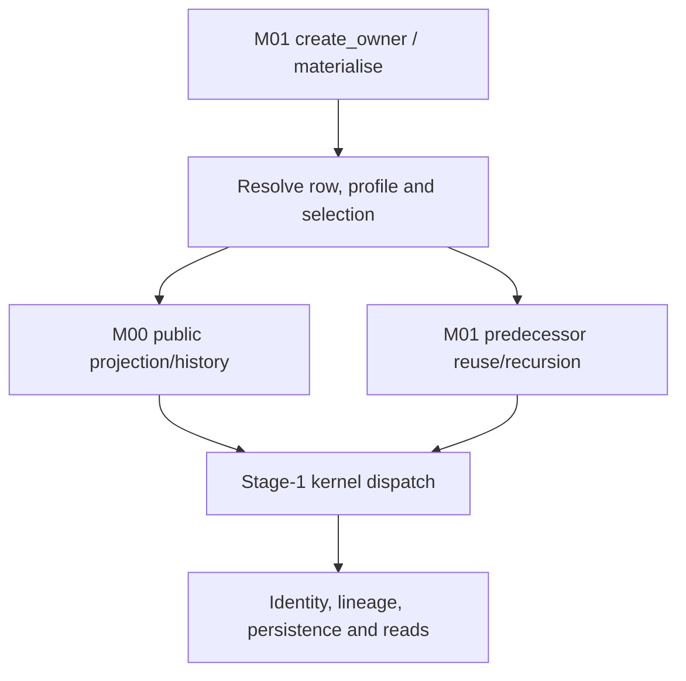

# NVDA V2 — cumulative Gates 3–4 assessment

Date: 17 October 2026 — Australia/Melbourne.

**Current result: G3.1 shared-path source inspection SATISFIED. Gate3 remains IN_PROGRESS; G3.2–G3.3 NOT_STARTED; Gate4 NOT_OPEN.** This is the worker's bounded documentary finding, not independent implementation acceptance, production readiness or a gate-exit decision. Current user instruction is Leaf3.1 only.

## 1. Authority, exact baseline and recovery failure

The owner stated: “Okay, I approve the draft. Execute Leaf 3.1.” The accepted proposal is `be288c23327face2ef9c43472903c9e0d450593d:handoff/workbook_v2/gates_03_04/EXEC_PLAN_GATES_03_04_PROPOSED_20261017.md`, tree `378cce1557c544c64a208c566ef04da216abb39a`, proposal SHA-256 `5db52a2c86e370038158022fabbdba9b8fe0b8b1033b5e37b695378d5d168c89`. Activation commit `f590504a2afc3391d223ce36512d2e62f35b85e5` installs the single root plan on `work/v2-g3-1-shared-execution-assessment-20261017`, preserving the proposed snapshot and old root at `c88abc1367a6c4c755673c68e7f72536decc2c2f:EXEC_PLAN.md`. Only activation/provenance/progress metadata changes the accepted plan body. GUARDRAILS/AGENTS remain frozen. Source references below describe the unchanged production tree at be288c2.

**First failed required invariant, preserved and reported:** the workspace initially held earlier clean5e59224, not the approved draft. Recovery of `NVDA_V2_GATE_2_ACCEPTED_GATES_03_04_DRAFT_FULL_GIT_20261017.tar.gz` produced16,241,379bytes and the previously recorded SHA-256 `45cc29705bbe6453593b93b25938f1920664c7f51c9a7c85039e9252cd8e2bc0`, but extraction failed `EOFError: Compressed file ended before the end-of-stream marker was reached`. The tar stream reached member2286, inside `.git/objects/pack/pack-77586ffba536ab0d6e5cb4c3d473ac9e9714dd94.pack`. Matching that checksum does not make the archive valid. The earlier claim that this delivered archive's extraction/readback passed is contradicted by this read and is not relied on. Activation and leaf work were paused until recovery was verified.

**Verified alternative recovery, not a substitute archive PASS:**1,947 fully recovered loose Git objects were decompressed and checked against their SHA-1 object identities. They include the exact approved be288c2 commit/tree and complete later authority/assessment objects. Those verified objects were combined in a new checkout with the intact5e59224 object database, whose identically named complete pack supplies the older history. The truncated pack was excluded. Full `git fsck --full`,5e59224→be288c2 ancestry, exact approved tree and clean checkout checks passed before activation. Source/governance bytes match the intact baseline. The failed archive/partial extraction and old checkout remain preserved outside this repository. Later archived branch/ref positions were not reached in that failed stream and are not claimed restored; intact earlier refs and the new current branch are retained. No history was pruned or rewritten. The approved content and full reachable Git object graph are recovered; the failed archive itself remains failed.

## 2. What G3.1 establishes

There is an existing public construction/materialisation/read path, a M00 field/history projection seam, versioned selection and context machinery, lineage/result carriers and optional PostgreSQL persistence. These are specific source mechanisms to investigate for reuse, not a complete neutral module ready to move wholesale. The owner controller combines those mechanisms with row-specific market/candidate/policy selection and current-M01 persistence assumptions.

The path is:

The arrows describe inspected source calls, not an executed production request. Numeric/candidate equations for all209rows are deliberately reserved for G3.2. No claimed result here depends on running a fixture, importing application code or connecting a database/provider.

## 3. Shared mechanism map

Paths abbreviated below: **D/**=`src/nvda_desk/derived_signal_calculation_truth/`; **R/**=`src/nvda_desk/raw_signal_occurrence_truth/`. Line references bind to the unchanged be288c2 production files, not to historical reviewed commits.

| Mechanism and semantic responsibility | Verified source path and actual behaviour | Boundary/evidence limit |
| --- | --- | --- |
| Construction and immutable references | D/api.py:317–344,516–606,649–678,835–920,1029–1053,3075–3183. `create_owner` accepts explicit M00 reader, mappings, parameter sets, policies, conventions, contexts, persistence and clock. It rejects duplicate identity/version entries within the supplied collections and indexes them by IDs/versions. `CalculationRequestV1` carries exact raw/profile/child-policy refs. | Frozen/reference/type checks are not semantic approval of parameter values or proof that the same version's meaning remains immutable across deployments. `calculation_definition_version` is a nonempty request string; the controller does not resolve it through a separately inspected accepted-definition registry. |
| Runtime row/kernel/dependency authority | D/_catalogue.py:1–157 verifies exact runtime CSV hash67bacbcf…, ordered D001–D209, admitted kernel IDs, resolved D edges and acyclicity. `materialise`→`_materialise` at D/api.py:2317–2366 loads that row; D/_stage1.py:21–34,3713–3803 dispatches K01–K08/K16/K17. | The catalogue admits names K09–K15 but the public materialiser returns no result for rows outside its Stage1 kernel set. This is a router-level observation, not a per-row implementation census. Semantic overlays accepted in Gate2 are not automatically loaded from Markdown. |
| Raw facts remain M00-owned | D/api.py:1245–1459 calls `reader.list_projected_raw_history` using exact M00 mapping objects and receipt cutoff. R/api.py:582–668,1094–1126,1739–1807 resolves one provider/source/R mapping, traverses native field paths and returns source/native-unit/identity metadata without deriving a D. | Explicit mapping is required; a catalogue tag alone does not select a field. Mapping-declared units/source paths still need actual source-conformity evidence. No IBKR acquisition/request/callback implementation is supplied by this seam. |
| Raw history enumeration and durable M00 read | R/api.py:1808–1878 selects observations, applies receipt/event criteria and subject filter, projects and orders by receipt, sequence scope, sequence and occurrence ID, returning offset pages. M01 consumes pages of1000until cursor exhaustion. R/api.py:1403–1415 delegates raw reads to the M00 durability port when present; R/_postgres.py:530–549,566–585,686–731 owns its read-only transactions and observation queries. | M01 never needs direct M00-table access. Current durable enumeration first reads the broad raw observation range and then filters/projects in Python; each page/individual lookup can use separate reads. A stable query order is not proof of one atomic source snapshot, exact completeness of an evolving native stream or production performance. |
| Time and knowledge remain distinct | D/api.py:1054–1075 parses true-instant source timestamps/timezones. `_raw_values` uses source instant for true-instant facts and receipt basis otherwise, retaining temporal kind; D/_stage1.py:305–340 checks permissions, receipt knowledge cutoff and true-instant/derived as-of. Latest-subject freshness is applied after preserving history. | Receipt/date-only data are not silently converted into provider event time. Actual permitted temporal basis and history/window law remain row-specific; this shared filter is not a blanket no-look-ahead proof for every calculation or post-hoc mode. |
| Subjects, units and exact join identity | D/api.py:1147–1244 enforces specific option/basket minimums and exact typed selection identities;1245–1459 checks binding subjects, mapping IDs/versions/native units and applies `UnitConventionVersionV1.convert` (516–536). It has separate basket/account-scope rules and a special R284 UTC-string path. | No magnitude heuristic is used by that conversion. Native-unit/source certification and each row's selected membership still require evidence. These minimums and special cases are domain logic inside the nominally shared owner, not an entirely generic evaluator. |
| Compatible predecessor reuse and recursion | D/api.py:1460–1598 merges selected identities, refuses ambiguity and preserves typed selection.1662–1730 filters stored predecessors by definition, cutoff/as-of, required parameter/selection/context refs, raw mappings/units and convention refs.2520–2890 recursively materialises supported predecessors, or requires compatible stored history for an unsupported predecessor; missing prerequisites return no parent. | There is one M01-owned graph, not independently admitted future peer seams. A seeded stored Stage2 occurrence in a test does not establish a production Stage2 producer. History completeness has the finite retrieval limit discussed below. |
| Domain-specific child selection and provenance | D/api.py:1599–1661 exposes retained actual producer refs, unit/currency domain and raw lineage as kernel metadata.1731–2176 implements explicit proxy/basket/option/candidate/grouped child policies;2177–2316 handles event revision/identity;2317–3067 adds per-row selection/trade/official-period/regression matching. D/_financial_policy.py:58–108 validates selected producer refs/time and exact single predecessor/context. | Matching labels alone do not prove actual producer correspondence. These helpers carry financial/strategy semantics as well as measurement semantics; copying the whole controller into the foundation would also copy those responsibilities. No new proof of every financial consumer is made here. |
| Calculation/result boundary | D/_stage1.py:38–74 defines input/result carriers;296–395 selects/collects kernel inputs and wraps results;3713–3803 calls family-specific numerical functions. Its `_eval_k08` at2969–2997 delegates D175/D178/D189/D192 to `_financial_policy`. | Pure calculation helpers are separable candidates, but row mathematical correctness/support is G3.2. Kernel family or file placement does not determine foundation eligibility. Returned `None` is absence; it is not persisted as a fabricated zero or semantic NULL. Exceptions can propagate from infrastructure/validation; no guarantee that every failure becomes `None` is asserted. |
| Identity, lineage and retry | D/_stage1.py:878–901 hashes D, definition string, subject, as-of/cutoff, sorted input IDs and version keys. D/api.py:2970–3067 unions/deduplicates selected raw lineage and direct predecessor IDs, records context/convention refs, returns an existing identity or appends a new occurrence with supersession. Carrier at750–798 preserves result/time/lineage/selection. | Module owner is absent from the occurrence hash. Configuration contents are represented by IDs/versions, not embedded or hashed payload definitions. Correct cross-version namespace/immutability and future writer/consumer migration must not be inferred from deterministic hashing alone. |
| Persistence and access ownership | D/api.py:951–1013 defines the occurrence persistence/read ports and memory implementation. `create_owner` defaults to memory when persistence is absent. D/_postgres.py:1–183 encodes typed results/refs/selection;190–332 rejects same M00 schema/role and effective table/column/SET ROLE capabilities;333–527 validates each connection, stores append-only occurrence rows and exposes exact get/bounded history. | PostgreSQL is an injected technical mechanism, not calculation owner or proof of deployed durability. Adapter SQL uses M01-owned `dsct_derived_signal_occurrence_v1`; referenced parameter/context definitions are supplied separately to owner construction. Actual roles, populated stores, consumers, privileges, recovery and full runtime behaviour were not observed. |
| External effects and composition | D/api.py exposes construction, `materialise` and reads; kernels return values and the persistence boundary writes occurrences. `modules.yaml` registers only active M00 and bootstrap/inactive/non-composable M01 with M00 as permitted dependency; `implementation_allocations.yaml` has M00/M01. | Calculated action-like values do not grant order/account authority. No M02 or downstream owner is admitted by this map. The absence of a broker command on this seam does not certify every runtime/environment outside the inspected scope. |

## 4. Material shared-boundary findings to carry forward

These are source findings and bounded limitations, not a new collection of owner-approval receipts. No code/test change is made. They are linked here once so G3.2 can reference the shared proposition and G3.3 can decide reuse by component.

| ID | Required proposition versus actual inspected source | Consequence and receiving work |
| --- | --- | --- |
| SM-01 — Separate generic mechanics from domain ownership | AK-OWN/DEP/SEAM and the accepted future design require bounded responsibilities and no downstream peer runtime dependence. Actual D/api.py combines graph/persistence mechanics with hard-coded option, proxy/basket, event, candidate, account-risk and grouped-join branches; `_financial_policy` owns financial-policy consumers. | **Verified separation requirement**, not evidence that the current monolithic M01 is itself unlawful under its old remit. G3.3 assesses reusable neutral pieces; G4.1 designs local peer chains. No whole-controller reuse or shared strategy layer is justified. |
| SM-02 — Runtime authority incorporation is separate from accepted meaning | Accepted D028/D117/L2 overlays govern meaning. Actual `_catalogue.py` loads only the unchanged hash-bound CSV, and `_materialise` uses its raw/D lists. No overlay-loader path appears in the traced public controller. | **Verified incorporation gap at the shared routing boundary.** G3.2 must compare each affected actual row path to its accepted amendment; later authorised work synchronises catalogue/hash/code/proof. Do not request the same mathematical approvals again or repair files during this leaf. |
| SM-03 — Preserve version definitions and historical reproducibility | Brief §§6,10,12–14 require exact immutable versions/provenance. Actual owner maps definitions in memory; occurrence/SQL encode references, while `_compatible_history` and hashing compare IDs/versions. | **Verified storage/construction shape; external definition lifecycle UNKNOWN.** G3.2 checks actual profile use; G3.3/G4.2 identify lawful definition retention/resolution and namespace guarantees before reuse/migration. Do not infer that a new configuration database is required, or that a source ID proves its contents never changed. |
| SM-04 — Treat historical retrieval limits as real limits | Brief §§8/13 make full authorised history necessary. `_compatible_history` and supersession lookup ask for at most100,000rows; both memory and PostgreSQL `list_occurrences` sort ascending and take the first limit, with no cursor on that port. | **Verified finite-history limitation**, not an observed missing live window. Beyond that population, the shared path cannot be assumed to examine all/latest eligible history; false refusal/latest-supersession scope requires row-specific assessment. G3.2 establishes exposure; G3.3 plans any necessary bounded selection/pagination proof. No arbitrary new horizon is invented. |
| SM-05 — Durable/atomic operation is not the default or a whole graph transaction | `create_owner` defaults to memory. The PostgreSQL adapter opens operation-level connections; recursion may persist predecessors before a parent later refuses. Native-read pagination and occurrence writes do not share one graph-wide transaction in this controller. | **Verified architecture, not a finding that graph-wide atomicity is required by authority.** Retain valid independent predecessors; distinguish sequential retry from concurrency/crash proof and a consistent input set from database snapshot assumptions. G3.3/G4.2 specify actual required durability/transaction/compatibility and independent evidence. Actual deployed persistence remains UNKNOWN. |
| SM-06 — Future owner identities cannot silently inherit old stored truth | Occurrence hash has no module owner; current store/carrier/role checks are M01-oriented and compare full contents for identity conflict. There is no admitted successor in current registry. | **Verified compatibility constraint; actual existing data/consumers UNKNOWN.** Preserve historical writer attribution and exact version identity. G3.3/G4.2 must resolve reader/writer/schema/identity compatibility, cutover/recovery and separate retirement before treating old occurrences as successor-owned. No stored result is relabelled here. |

Each finding states a present source fact and a separate consequence. It does not use a missing test run as proof of a defect. Controlled history fixtures, construction-time type checks or a parameter name do not discharge actual source/profile sufficiency.

## 5. Evidence actually examined and its limits

**Normative reading:** active approved plan and master-derived scope; original calculation brief §§6–18/AppendixA; current module/allocation registry; ownership/state, dependency, public-seam and test/promotion laws; accepted Gate2 authority/exit records and their source-versus-instance distinction. Shared production inspection covered D/_catalogue.py in full, D/api.py construction/request/occurrence/persistence ports and the complete owner materialisation/selection/scoped-child/history/result path, D/_postgres.py in full, R/api.py projection types/read wrappers/raw lookup/project/history functions and R/_postgres.py transaction/observation-read methods. D/_stage1.py shared carriers, eligible-value/result/identity helpers, full dispatcher and financial-policy bridge were read; D/_financial_policy.py shared structured-number/context/producer-evidence helpers were inspected. This is not a claim to have semantically audited every numerical row branch or every M00 acquisition/storage operation.

| Evidence inspected | Proposition it supplies | What it does not establish here |
| --- | --- | --- |
| `tests/product/derived_signal/test_ds_t01_foundation_contract.py` relevant carrier/unit/absence/no-effects tests and `test_ds_t01_r01_foundation_contract_refinement.py` context/lineage/event-filter tests | Source assertions cover frozen/reference carriers, explicit affine unit conversion, absence distinction, restricted effect surface and separate receipt/event filtering. | Test-source presence is not a fresh passing run or current whole-module correctness. |
| `tests/product/derived_signal/test_m01_stage1_leaf2_temporal_graph.py` setup and cutoff/retry/context/mapping-unit-version/anchor tests | Controlled public D013 input/time/version cases, stable retry/changed cutoff append, exact compatible-history refs and no future nearest-anchor substitution are asserted. | Does not prove every row or native timestamp/history source. Some history checks call private helpers, so they are not all independent public-path proofs. |
| `test_m01_stage1_selection_lineage.py` selected public mismatch tests and seeded-predecessor setup | Exact selection identity is preserved/checked in raw-to-D and D-to-D paths. The D190 case explicitly seeds Stage2 occurrences. | A seeded predecessor is not a production implementation of D165/D188 or downstream self-sufficiency. |
| `tests/implementation/derived_signal/test_ds_t01_selection_lineage_persistence.py` complete roundtrip case | It calls actual PostgreSQL adapter and asserts exact selection identity/Decimal strike roundtrip, with separate M00/M01 DSNs required. | No database was connected in this pass; current data/permissions/durability and all result shapes remain unproved here. |
| `test_ds_t01_r05_postgres_role_membership_refinement.py` direct SET ROLE, harmless-membership and operation-time drift cases | Test source targets assumable-role isolation and repeat validation after construction. | Not executed now; does not make all actual database roles safe by inspection. |
| `review/DS_R01_FOUNDATION_PASS.json` verdict/route/source identity; `AUTHORITY_INDEX.md` scoped foundation boundary | Historical PASS is bound to14a6085b…/treed0efb6ec…, not be288c2. Foundation-only acceptance remains bounded. | Embedded historic packets/governance are not current plan authority or a new acceptance of all kernels. |
| `review/M01_F2_CONSOLIDATED_INDEPENDENT_REVIEW_20261009.md` | Historical bounded F2 acceptance: controlled observation/event correlation,18specified edges, independently reported34focused and693selected cases,44M01 PG cases at867b875b…; explicit source/native/M00 durability exclusions. | Counts are historical reported reviewer evidence, not rerun results. No current/source integration or whole-Stage1/M01/successor PASS follows. |
| `r02_d120_review/FINAL_DISPOSITION.md`; Gate1 F4 reconciliation and selected F3/F4 pause/review sections | Bounded later repairs/accepted meanings coexist with supported-runtime/DB and repaired-final-tree review debt. Actual metadata correspondence has historically failed and must not be inferred from labels. | This leaf does not independently re-review F4 repairs, repeat those old defects as current, or certify a full174/144/30population. |

No tests, application imports/execution, lint/typecheck, runtime validators, database operations or provider/network operations ran. File parsing, Git inspection, object/hash checks and source/test reading are the evidence obtained. `pyproject.toml` pins Python3.13.5 and Psycopg3.3.4; no supported execution environment was commissioned or certified. README/old continuation directions are historical navigation; the activated root plan and current Leaf3.1 instruction govern.

## 6. Leaf outcome, preservation and next step

**G3.1 source-inspection obligation is satisfied:** the public entry-to-selection-to-predecessor/kernel-to-persistence/read mechanisms are mapped, semantic ownership and time/version/state responsibilities are distinguished, specific shared-boundary gaps/limits have source locations and receiving work, and unknown runtime facts are not mislabelled missing inspection. There is no independent review or whole-module acceptance claim. Gate3 remains incomplete.

The126/83classification,209-row traceability register, existing issue/link populations and accepted mathematics are unchanged. G3.2 row-specific implementation/evidence cells remain as they were; this shared inspection does not fill them favourably. Root plan progress and this one cumulative report are the only intended changes after activation; source/tests/catalogues/workbooks/registries/governance/main remain unchanged.

Next semantic unit is **G3.2**, starting from the shared map above and the effective accepted per-D authority. Its209-row actual-progress census, per-row reuse conclusions, peer-local design and implementation roadmap have not been performed. The current instruction stops after Leaf3.1; no permission question is manufactured for completing this already authorised leaf.
