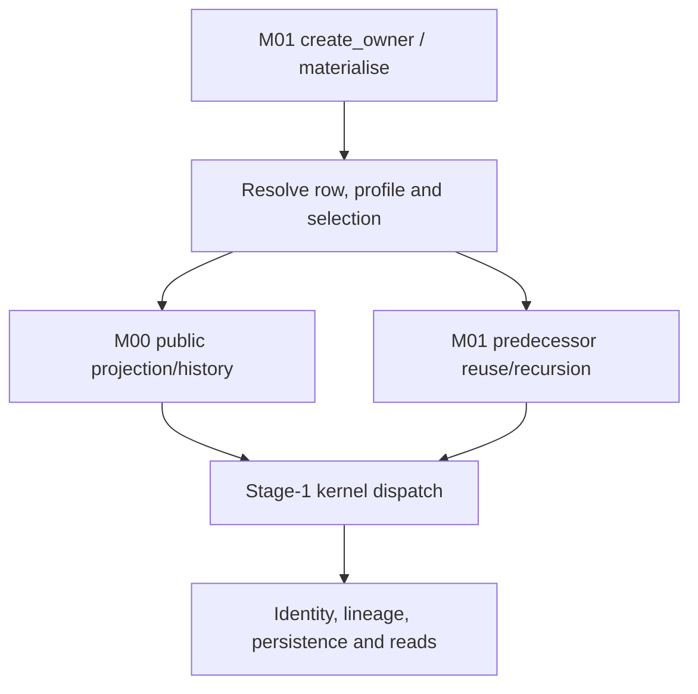

# NVDA V2 — cumulative Gates 3–4 assessment

Date: 17 October 2026 — Australia/Melbourne.

**Current result: Gate3 ACCEPTED_AND_CLOSED; Gate4 ACCEPTED_AND_CLOSED; current Gates3–4 ExecPlan COMPLETED_AND_CLOSED and RETIRED_FROM_ACTIVE_EXECUTION.** All five documentary leaves are complete within their stated limits. Section21 records owner acceptance; sections1–20 preserve earlier checkpoints and decision-pending text as history. No successor plan is activated and no production/source/profile/module admission follows from these planning decisions.

## 1. Authority, exact baseline and recovery failure

The owner stated: “Okay, I approve the draft. Execute Leaf 3.1.” The accepted proposal is `be288c23327face2ef9c43472903c9e0d450593d:handoff/workbook_v2/gates_03_04/EXEC_PLAN_GATES_03_04_PROPOSED_20261017.md`, tree `378cce1557c544c64a208c566ef04da216abb39a`, proposal SHA-256 `5db52a2c86e370038158022fabbdba9b8fe0b8b1033b5e37b695378d5d168c89`. Activation commit `f590504a2afc3391d223ce36512d2e62f35b85e5` installs the single root plan on `work/v2-g3-1-shared-execution-assessment-20261017`, preserving the proposed snapshot and old root at `c88abc1367a6c4c755673c68e7f72536decc2c2f:EXEC_PLAN.md`. Only activation/provenance/progress metadata changes the accepted plan body. GUARDRAILS/AGENTS remain frozen. Source references below describe the unchanged production tree at be288c2.

**First failed required invariant, preserved and reported:** the workspace initially held earlier clean5e59224, not the approved draft. Recovery of `NVDA_V2_GATE_2_ACCEPTED_GATES_03_04_DRAFT_FULL_GIT_20261017.tar.gz` produced16,241,379bytes and the previously recorded SHA-256 `45cc29705bbe6453593b93b25938f1920664c7f51c9a7c85039e9252cd8e2bc0`, but extraction failed `EOFError: Compressed file ended before the end-of-stream marker was reached`. The tar stream reached member2286, inside `.git/objects/pack/pack-77586ffba536ab0d6e5cb4c3d473ac9e9714dd94.pack`. Matching that checksum does not make the archive valid. The earlier claim that this delivered archive's extraction/readback passed is contradicted by this read and is not relied on. Activation and leaf work were paused until recovery was verified.

**Verified alternative recovery, not a substitute archive PASS:**1,947 fully recovered loose Git objects were decompressed and checked against their SHA-1 object identities. They include the exact approved be288c2 commit/tree and complete later authority/assessment objects. Those verified objects were combined in a new checkout with the intact5e59224 object database, whose identically named complete pack supplies the older history. The truncated pack was excluded. Full `git fsck --full`,5e59224→be288c2 ancestry, exact approved tree and clean checkout checks passed before activation. Source/governance bytes match the intact baseline. The failed archive/partial extraction and old checkout remain preserved outside this repository. Later archived branch/ref positions were not reached in that failed stream and are not claimed restored; intact earlier refs and the new current branch are retained. No history was pruned or rewritten. The approved content and full reachable Git object graph are recovered; the failed archive itself remains failed.

## 2. What G3.1 establishes

There is an existing public construction/materialisation/read path, a M00 field/history projection seam, versioned selection and context machinery, lineage/result carriers and optional PostgreSQL persistence. These are specific source mechanisms to investigate for reuse, not a complete neutral module ready to move wholesale. The owner controller combines those mechanisms with row-specific market/candidate/policy selection and current-M01 persistence assumptions.

The path is:

The arrows describe inspected source calls, not an executed production request. Numeric/candidate equations for all209rows are deliberately reserved for G3.2. No claimed result here depends on running a fixture, importing application code or connecting a database/provider.

## 3. Shared mechanism map

Paths abbreviated below: **D/**=`src/nvda_desk/derived_signal_calculation_truth/`; **R/**=`src/nvda_desk/raw_signal_occurrence_truth/`. Line references bind to the unchanged be288c2 production files, not to historical reviewed commits.

| Mechanism and semantic responsibility | Verified source path and actual behaviour | Boundary/evidence limit |
| --- | --- | --- |
| Construction and immutable references | D/api.py:317–344,516–606,649–678,835–920,1029–1053,3075–3183. `create_owner` accepts explicit M00 reader, mappings, parameter sets, policies, conventions, contexts, persistence and clock. It rejects duplicate identity/version entries within the supplied collections and indexes them by IDs/versions. `CalculationRequestV1` carries exact raw/profile/child-policy refs. | Frozen/reference/type checks are not semantic approval of parameter values or proof that the same version's meaning remains immutable across deployments. `calculation_definition_version` is a nonempty request string; the controller does not resolve it through a separately inspected accepted-definition registry. |
| Runtime row/kernel/dependency authority | D/_catalogue.py:1–157 verifies exact runtime CSV hash67bacbcf…, ordered D001–D209, admitted kernel IDs, resolved D edges and acyclicity. `materialise`→`_materialise` at D/api.py:2317–2366 loads that row; D/_stage1.py:21–34,3713–3803 dispatches K01–K08/K16/K17. | The catalogue admits names K09–K15 but the public materialiser returns no result for rows outside its Stage1 kernel set. This is a router-level observation, not a per-row implementation census. Semantic overlays accepted in Gate2 are not automatically loaded from Markdown. |
| Raw facts remain M00-owned | D/api.py:1245–1459 calls `reader.list_projected_raw_history` using exact M00 mapping objects and receipt cutoff. R/api.py:582–668,1094–1126,1739–1807 resolves one provider/source/R mapping, traverses native field paths and returns source/native-unit/identity metadata without deriving a D. | Explicit mapping is required; a catalogue tag alone does not select a field. Mapping-declared units/source paths still need actual source-conformity evidence. No IBKR acquisition/request/callback implementation is supplied by this seam. |
| Raw history enumeration and durable M00 read | R/api.py:1808–1878 selects observations, applies receipt/event criteria and subject filter, projects and orders by receipt, sequence scope, sequence and occurrence ID, returning offset pages. M01 consumes pages of1000until cursor exhaustion. R/api.py:1403–1415 delegates raw reads to the M00 durability port when present; R/_postgres.py:530–549,566–585,686–731 owns its read-only transactions and observation queries. | M01 never needs direct M00-table access. Current durable enumeration first reads the broad raw observation range and then filters/projects in Python; each page/individual lookup can use separate reads. A stable query order is not proof of one atomic source snapshot, exact completeness of an evolving native stream or production performance. |
| Time and knowledge remain distinct | D/api.py:1054–1075 parses true-instant source timestamps/timezones. `_raw_values` uses source instant for true-instant facts and receipt basis otherwise, retaining temporal kind; D/_stage1.py:305–340 checks permissions, receipt knowledge cutoff and true-instant/derived as-of. Latest-subject freshness is applied after preserving history. | Receipt/date-only data are not silently converted into provider event time. Actual permitted temporal basis and history/window law remain row-specific; this shared filter is not a blanket no-look-ahead proof for every calculation or post-hoc mode. |
| Subjects, units and exact join identity | D/api.py:1147–1244 enforces specific option/basket minimums and exact typed selection identities;1245–1459 checks binding subjects, mapping IDs/versions/native units and applies `UnitConventionVersionV1.convert` (516–536). It has separate basket/account-scope rules and a special R284 UTC-string path. | No magnitude heuristic is used by that conversion. Native-unit/source certification and each row's selected membership still require evidence. These minimums and special cases are domain logic inside the nominally shared owner, not an entirely generic evaluator. |
| Compatible predecessor reuse and recursion | D/api.py:1460–1598 merges selected identities, refuses ambiguity and preserves typed selection.1662–1730 filters stored predecessors by definition, cutoff/as-of, required parameter/selection/context refs, raw mappings/units and convention refs.2520–2890 recursively materialises supported predecessors, or requires compatible stored history for an unsupported predecessor; missing prerequisites return no parent. | There is one M01-owned graph, not independently admitted future peer seams. A seeded stored Stage2 occurrence in a test does not establish a production Stage2 producer. History completeness has the finite retrieval limit discussed below. |
| Domain-specific child selection and provenance | D/api.py:1599–1661 exposes retained actual producer refs, unit/currency domain and raw lineage as kernel metadata.1731–2176 implements explicit proxy/basket/option/candidate/grouped child policies;2177–2316 handles event revision/identity;2317–3067 adds per-row selection/trade/official-period/regression matching. D/_financial_policy.py:58–108 validates selected producer refs/time and exact single predecessor/context. | Matching labels alone do not prove actual producer correspondence. These helpers carry financial/strategy semantics as well as measurement semantics; copying the whole controller into the foundation would also copy those responsibilities. No new proof of every financial consumer is made here. |
| Calculation/result boundary | D/_stage1.py:38–74 defines input/result carriers;296–395 selects/collects kernel inputs and wraps results;3713–3803 calls family-specific numerical functions. Its `_eval_k08` at2969–2997 delegates D175/D178/D189/D192 to `_financial_policy`. | Pure calculation helpers are separable candidates, but row mathematical correctness/support is G3.2. Kernel family or file placement does not determine foundation eligibility. Returned `None` is absence; it is not persisted as a fabricated zero or semantic NULL. Exceptions can propagate from infrastructure/validation; no guarantee that every failure becomes `None` is asserted. |
| Identity, lineage and retry | D/_stage1.py:878–901 hashes D, definition string, subject, as-of/cutoff, sorted input IDs and version keys. D/api.py:2970–3067 unions/deduplicates selected raw lineage and direct predecessor IDs, records context/convention refs, returns an existing identity or appends a new occurrence with supersession. Carrier at750–798 preserves result/time/lineage/selection. | Module owner is absent from the occurrence hash. Configuration contents are represented by IDs/versions, not embedded or hashed payload definitions. Correct cross-version namespace/immutability and future writer/consumer migration must not be inferred from deterministic hashing alone. |
| Persistence and access ownership | D/api.py:951–1013 defines the occurrence persistence/read ports and memory implementation. `create_owner` defaults to memory when persistence is absent. D/_postgres.py:1–183 encodes typed results/refs/selection;190–332 rejects same M00 schema/role and effective table/column/SET ROLE capabilities;333–527 validates each connection, stores append-only occurrence rows and exposes exact get/bounded history. | PostgreSQL is an injected technical mechanism, not calculation owner or proof of deployed durability. Adapter SQL uses M01-owned `dsct_derived_signal_occurrence_v1`; referenced parameter/context definitions are supplied separately to owner construction. Actual roles, populated stores, consumers, privileges, recovery and full runtime behaviour were not observed. |
| External effects and composition | D/api.py exposes construction, `materialise` and reads; kernels return values and the persistence boundary writes occurrences. `modules.yaml` registers only active M00 and bootstrap/inactive/non-composable M01 with M00 as permitted dependency; `implementation_allocations.yaml` has M00/M01. | Calculated action-like values do not grant order/account authority. No M02 or downstream owner is admitted by this map. The absence of a broker command on this seam does not certify every runtime/environment outside the inspected scope. |

## 4. Material shared-boundary findings to carry forward

These are source findings and bounded limitations, not a new collection of owner-approval receipts. No code/test change is made. They are linked here once so G3.2 can reference the shared proposition and G3.3 can decide reuse by component.

| ID | Required proposition versus actual inspected source | Consequence and receiving work |
| --- | --- | --- |
| SM-01 — Separate generic mechanics from domain ownership | AK-OWN/DEP/SEAM and the accepted future design require bounded responsibilities and no downstream peer runtime dependence. Actual D/api.py combines graph/persistence mechanics with hard-coded option, proxy/basket, event, candidate, account-risk and grouped-join branches; `_financial_policy` owns financial-policy consumers. | **Verified separation requirement**, not evidence that the current monolithic M01 is itself unlawful under its old remit. G3.3 assesses reusable neutral pieces; G4.1 designs local peer chains. No whole-controller reuse or shared strategy layer is justified. |
| SM-02 — Runtime authority incorporation is separate from accepted meaning | Accepted D028/D117/L2 overlays govern meaning. Actual `_catalogue.py` loads only the unchanged hash-bound CSV, and `_materialise` uses its raw/D lists. No overlay-loader path appears in the traced public controller. | **Verified incorporation gap at the shared routing boundary.** G3.2 must compare each affected actual row path to its accepted amendment; later authorised work synchronises catalogue/hash/code/proof. Do not request the same mathematical approvals again or repair files during this leaf. |
| SM-03 — Preserve version definitions and historical reproducibility | Brief §§6,10,12–14 require exact immutable versions/provenance. Actual owner maps definitions in memory; occurrence/SQL encode references, while `_compatible_history` and hashing compare IDs/versions. | **Verified storage/construction shape; external definition lifecycle UNKNOWN.** G3.2 checks actual profile use; G3.3/G4.2 identify lawful definition retention/resolution and namespace guarantees before reuse/migration. Do not infer that a new configuration database is required, or that a source ID proves its contents never changed. |
| SM-04 — Treat historical retrieval limits as real limits | Brief §§8/13 make full authorised history necessary. `_compatible_history` and supersession lookup ask for at most100,000rows; both memory and PostgreSQL `list_occurrences` sort ascending and take the first limit, with no cursor on that port. | **Verified finite-history limitation**, not an observed missing live window. Beyond that population, the shared path cannot be assumed to examine all/latest eligible history; false refusal/latest-supersession scope requires row-specific assessment. G3.2 establishes exposure; G3.3 plans any necessary bounded selection/pagination proof. No arbitrary new horizon is invented. |
| SM-05 — Durable/atomic operation is not the default or a whole graph transaction | `create_owner` defaults to memory. The PostgreSQL adapter opens operation-level connections; recursion may persist predecessors before a parent later refuses. Native-read pagination and occurrence writes do not share one graph-wide transaction in this controller. | **Verified architecture, not a finding that graph-wide atomicity is required by authority.** Retain valid independent predecessors; distinguish sequential retry from concurrency/crash proof and a consistent input set from database snapshot assumptions. G3.3/G4.2 specify actual required durability/transaction/compatibility and independent evidence. Actual deployed persistence remains UNKNOWN. |
| SM-06 — Future owner identities cannot silently inherit old stored truth | Occurrence hash has no module owner; current store/carrier/role checks are M01-oriented and compare full contents for identity conflict. There is no admitted successor in current registry. | **Verified compatibility constraint; actual existing data/consumers UNKNOWN.** Preserve historical writer attribution and exact version identity. G3.3/G4.2 must resolve reader/writer/schema/identity compatibility, cutover/recovery and separate retirement before treating old occurrences as successor-owned. No stored result is relabelled here. |

Each finding states a present source fact and a separate consequence. It does not use a missing test run as proof of a defect. Controlled history fixtures, construction-time type checks or a parameter name do not discharge actual source/profile sufficiency.

## 5. Evidence actually examined and its limits

**Normative reading:** active approved plan and master-derived scope; original calculation brief §§6–18/AppendixA; current module/allocation registry; ownership/state, dependency, public-seam and test/promotion laws; accepted Gate2 authority/exit records and their source-versus-instance distinction. Shared production inspection covered D/_catalogue.py in full, D/api.py construction/request/occurrence/persistence ports and the complete owner materialisation/selection/scoped-child/history/result path, D/_postgres.py in full, R/api.py projection types/read wrappers/raw lookup/project/history functions and R/_postgres.py transaction/observation-read methods. D/_stage1.py shared carriers, eligible-value/result/identity helpers, full dispatcher and financial-policy bridge were read; D/_financial_policy.py shared structured-number/context/producer-evidence helpers were inspected. This is not a claim to have semantically audited every numerical row branch or every M00 acquisition/storage operation.

| Evidence inspected | Proposition it supplies | What it does not establish here |
| --- | --- | --- |
| `tests/product/derived_signal/test_ds_t01_foundation_contract.py` relevant carrier/unit/absence/no-effects tests and `test_ds_t01_r01_foundation_contract_refinement.py` context/lineage/event-filter tests | Source assertions cover frozen/reference carriers, explicit affine unit conversion, absence distinction, restricted effect surface and separate receipt/event filtering. | Test-source presence is not a fresh passing run or current whole-module correctness. |
| `tests/product/derived_signal/test_m01_stage1_leaf2_temporal_graph.py` setup and cutoff/retry/context/mapping-unit-version/anchor tests | Controlled public D013 input/time/version cases, stable retry/changed cutoff append, exact compatible-history refs and no future nearest-anchor substitution are asserted. | Does not prove every row or native timestamp/history source. Some history checks call private helpers, so they are not all independent public-path proofs. |
| `test_m01_stage1_selection_lineage.py` selected public mismatch tests and seeded-predecessor setup | Exact selection identity is preserved/checked in raw-to-D and D-to-D paths. The D190 case explicitly seeds Stage2 occurrences. | A seeded predecessor is not a production implementation of D165/D188 or downstream self-sufficiency. |
| `tests/implementation/derived_signal/test_ds_t01_selection_lineage_persistence.py` complete roundtrip case | It calls actual PostgreSQL adapter and asserts exact selection identity/Decimal strike roundtrip, with separate M00/M01 DSNs required. | No database was connected in this pass; current data/permissions/durability and all result shapes remain unproved here. |
| `test_ds_t01_r05_postgres_role_membership_refinement.py` direct SET ROLE, harmless-membership and operation-time drift cases | Test source targets assumable-role isolation and repeat validation after construction. | Not executed now; does not make all actual database roles safe by inspection. |
| `review/DS_R01_FOUNDATION_PASS.json` verdict/route/source identity; `AUTHORITY_INDEX.md` scoped foundation boundary | Historical PASS is bound to14a6085b…/treed0efb6ec…, not be288c2. Foundation-only acceptance remains bounded. | Embedded historic packets/governance are not current plan authority or a new acceptance of all kernels. |
| `review/M01_F2_CONSOLIDATED_INDEPENDENT_REVIEW_20261009.md` | Historical bounded F2 acceptance: controlled observation/event correlation,18specified edges, independently reported34focused and693selected cases,44M01 PG cases at867b875b…; explicit source/native/M00 durability exclusions. | Counts are historical reported reviewer evidence, not rerun results. No current/source integration or whole-Stage1/M01/successor PASS follows. |
| `r02_d120_review/FINAL_DISPOSITION.md`; Gate1 F4 reconciliation and selected F3/F4 pause/review sections | Bounded later repairs/accepted meanings coexist with supported-runtime/DB and repaired-final-tree review debt. Actual metadata correspondence has historically failed and must not be inferred from labels. | This leaf does not independently re-review F4 repairs, repeat those old defects as current, or certify a full174/144/30population. |

No tests, application imports/execution, lint/typecheck, runtime validators, database operations or provider/network operations ran. File parsing, Git inspection, object/hash checks and source/test reading are the evidence obtained. `pyproject.toml` pins Python3.13.5 and Psycopg3.3.4; no supported execution environment was commissioned or certified. README/old continuation directions are historical navigation; the activated root plan and current Leaf3.1 instruction govern.

## 6. Leaf outcome, preservation and next step

**G3.1 source-inspection obligation is satisfied:** the public entry-to-selection-to-predecessor/kernel-to-persistence/read mechanisms are mapped, semantic ownership and time/version/state responsibilities are distinguished, specific shared-boundary gaps/limits have source locations and receiving work, and unknown runtime facts are not mislabelled missing inspection. There is no independent review or whole-module acceptance claim. Gate3 remains incomplete.

The126/83classification,209-row traceability register, existing issue/link populations and accepted mathematics are unchanged. G3.2 row-specific implementation/evidence cells remain as they were; this shared inspection does not fill them favourably. Root plan progress and this one cumulative report are the only intended changes after activation; source/tests/catalogues/workbooks/registries/governance/main remain unchanged.

Next semantic unit is **G3.2**, starting from the shared map above and the effective accepted per-D authority. Its209-row actual-progress census, per-row reuse conclusions, peer-local design and implementation roadmap have not been performed. The current instruction stops after Leaf3.1; no permission question is manufactured for completing this already authorised leaf.

## 7. G3.2 — actual original-M01 progress, all209 identities

### Practical conclusion and exact evidence boundary

There is substantial existing calculation engineering, but the original M01 brief is unfinished. Each D001–D209 has an individual effective-requirement/path/evidence disposition in the existing traceability register. The full own calculation source was read, including complete helper/caller contexts. No row's conclusion is derived solely from a dispatch marker. Missing advanced producers, mismatches to accepted overlays, native source/profile gaps and acceptance debt are separate findings. G3.2 assesses these facts; G3.3 will determine foundation reuse and receiving work. This leaf does not recommend finishing the old monolithic schedule.

Entry was clean `bfbdf2074fbf6f6c210637914bed9e9f46ff3129`; branch `work/v2-g3-2-original-calculation-assessment-20261017`. Entry `git fsck --full` exited0, with retained dangling objects. Current production/tests/configuration and pyproject bytes are identical to the bounded R02 source `50cf2fe05bc5f3fb8e17c74ba31360dcbe63ea3a` by Git tree comparison. That supports exact source correspondence, not current-runtime test acceptance. The accepted root plan and current owner instruction supersede the earlier Leaf3.1-only execution limit. No preceding gate or mathematical approval is reopened.

| Distinct source proposition | Population | Meaning and limit |
| --- | ---: | --- |
| Existing own calculation path in K01–K08/K16/K17 | 174 | Each own branch/helper was read against the effective row rule. Presence is not numerical conformance, source admission or passing execution. |
| Dependency graph stays within that implemented kernel set | 144 | A public recursive source path exists; actual profile/history availability and semantic discrepancies can still prevent or invalidate a result. This is not144 completed calculations. |
| Existing own kernel has an unavailable advanced predecessor in its static closure | 30 | Own arithmetic can be exercised with controlled predecessors. Full self-contained public production is unavailable; sufficiently compatible externally seeded stored occurrences can be reused by the owner but are not supplied by an implemented producer. |
| No current producer for accepted K09–K15 calculation | 35 | The public owner returns before evaluating these rows, dispatcher has no corresponding implementation and inspected SQL adapter stores occurrences only. A catalogue/type/fixture is not a producer. |

The35absent producers are **D096,D102,D111,D112,D113,D114,D115,D125,D126,D127,D129,D130,D133,D152,D153,D154,D160,D161,D162,D165,D169,D174,D177,D188,D194,D195,D196,D197,D198,D201,D202,D203,D204,D205,D206**. Their exact per-row accepted operations are retained in `G3_2_Actual_Own_Behaviour`; no implementation was added. D204/D205's zero signal edges do not make their EvaluationSet mathematics implemented.

The30cross-stage own kernels are **D097,D098,D107,D108,D128,D155,D156,D157,D158,D159,D163,D164,D166,D167,D171,D172,D173,D175,D176,D178,D186,D187,D189,D190,D191,D192,D199,D200,D207,D208**. The register explicitly names every absent transitive producer, not merely the first missing edge. In the unchanged126/83Gate2 allocation,121foundation candidates and53downstream calculations have own source paths;5foundation candidates (**D096,D102,D111,D112,D113**) and30downstream calculations have absent producers. These cross-tabs describe source availability, not reuse readiness or completion percentages.

### How to read the enriched register

Existing canonical, original/historical, effective G2, classification, proposed-owner and PB source-hold cells are preserved. Seven original implementation/evidence fields now contain current documentary assessments: implementation location/behaviour, own kernel, public reachability, persistence/lineage, test-source proposition, historical execution and independent acceptance. `Reuse_Disposition` remains UNASSESSED deliberately: it belongs to G3.3. Outstanding-work/evidence fields are extended without discarding prior obligations. Additional `G3_2_*` fields bind the baseline, effective requirement, individual actual behaviour/function span, missing producer closure, source-contract readiness, selection/refusal and direct issues.

**VERIFIED** means the stated source path/absence or discrepancy was established by reading. **UNKNOWN** in source/profile/runtime/proof fields means actual instance/evidence is not established. It does not mean the own code was left unread. There are no uninspected own-code rows in this census. This is not an exhaustive numerical proof or exhaustive audit of every existing test: selected test evidence has an explicit bounded disposition. Unexecuted current-runtime correctness and independent acceptance remain unknown rather than silently promoted.

## 8. Material source findings and accepted-contract differences

The shared SM-01–SM-06 findings remain applicable. New direct findings are appended to the existing issue register; its original21issue rows and124links are preserved cell-for-cell. There are now35issues and196direct issue-to-D links. The14new issues are findings to receive in G3.3/G4, **not fourteen new owner approval gates**, and not a demand to implement another module during this investigation. Static descendant exposure is listed separately from direct defects; it is not a claim that every exposed descendant has independently reproduced wrong output.

D/ below continues to mean `src/nvda_desk/derived_signal_calculation_truth/`. Exact accepted requirements and source locations are recorded independently of observed source behaviour:

| Issue | Required and observed distinction | Required receiving work |
| --- | --- | --- |
| G3I-001 — ABSENT_ADVANCED_PRODUCERS (D096, D102, D111, D112, D113, D114, D115, D125, D126, D127, D129, D130, D133, D152, D153, D154, D160, D161, D162, D165, D169, D174, D177, D188, D194, D195, D196, D197, D198, D201, D202, D203, D204, D205, D206) | **Required:** Accepted K09-K15 equations require actual producer implementations; every materialisation of these rows returns before kernel evaluation. **Observed source:** No alternative executable producer or owner SQL path exists in inspected src/config; compatible seeded stored values are not producers. D096 is specifically included, not discarded because of old Stage2 placement. Source: D/api.py:2317-2328; _stage1.py:3713-3781; _catalogue.py:14-30. | Later authorised calculation implementation and producer/consumer proof after G3.3 allocation and G4 sequencing. |
| G3I-002 — ACCEPTED_OVERLAY_NOT_INCORPORATED (D028, D117, D138, D145) | **Required:** Accepted D028/D117 R041-only and D138/D145 five-field positional contracts govern; runtime CSV and kernels retain earlier meanings. **Observed source:** D028 still demands R044-as-fraction; D117 still demands R075 and arbitrary count; D138 fits event triples without reconstruction; D145 remains price-keyed and has no R185. Numerical approvals remain effective; no reapproval requested. Source: D/_catalogue.py:12,66-104; api.py:2325-2366; _stage1.py:2333-2485,2685-2735,3616-3710. | Later authorised synchronisation of two CSVs/hash, calculation/selection code and authority-derived fixtures; retain B4 source holds. |
| G3I-003 — MACRO_VINTAGE_CLASSIFICATION (D009) | **Required:** K01 requires mutually exclusive initial/revised/latest-known categories for each applicable visible vintage at cutoff. **Observed source:** Branch selects newest received row and classifies by visible row count only; there is no revised output branch or explicit vintage deduplication. Existing tests cover single/two rows and incomplete latest refusal, not the full vintage law. Source: D/_stage1.py:1253-1297; tests/product/derived_signal/test_m01_f4_macro_vintage_public.py. | Later bounded vintage-identity/selection repair and independent authority-derived initial/older-revised/latest/duplicate/cutoff proofs; SRC-MACRO contract remains separate. |
| G3I-004 — AGGREGATION_WINDOW_NOT_APPLIED (D016, D017, D018, D120, D121, D122, D139, D140, D141, D142) | **Required:** Named session/rolling windows must select actual contributing inputs and retain required pre-window book warm-up separately. **Observed source:** Raw loader enumerates all visible history. Signed sums/VWAP do not filter a lower window boundary; book rates divide all reconstructed selected mutations by window_seconds; replenishment/resilience have no finite window selection. Grouped flow inherits the missing D120 window. Source: D/api.py:1245-1457; _stage1.py:1406-1422,2998-3004,3100-3250,3323-3498. | Later source-grounded window/session selectors, boundary/warm-up/refusal/lineage proof; do not shorten history or change equations here. |
| G3I-005 — ORDERED_BOOK_NATIVE_AND_STATE_CONTRACT (D131, D134, D135, D136, D138, D139, D140, D141, D142, D143, D144, D145) | **Required:** Accepted ordered native categorical interpretation, stream/generation/reset/readiness and positional reconstruction must establish the selected book before dependent outputs. **Observed source:** Text operation/side labels are expected; numeric native enums are not interpreted by an admitted mapping here. Sequence scope/generation/readiness/reset317 are not enforced. R185/R187 overlay gaps are separate. D139/140 omit zero-size events from counts and reject level0; D145 batches effective times and uses inclusive start. Contiguous indices do not certify completeness. Source: D/_stage1.py:700-865,1637-1746,2685-2735,3323-3498,3616-3710; api.py:1382-1397. | Separate upstream acquisition/source-contract responsibility supplies evidence through M00; later admitted calculation-state implementation proves positional/readiness/reset/window behaviour. No IBKR API implementation or integration in this leaf. |
| G3I-006 — DTE_DOMAIN_NOT_INCORPORATED (D122) | **Required:** Accepted N8 first domain groups by exact non-negative integer DTE_n and expiry. **Observed source:** Existing branch groups D085 through arbitrary configured dte_bucket_boundaries/labels. It does not enforce the accepted exact-integer-only first domain; common window issue is separately G3I-004. Source: D/_stage1.py:3142-3249; accepted B/S/N package N8. | Later profile/domain incorporation and exact DTE join/output tests; no new DTE definition decision needed. |
| G3I-007 — STRUCTURED_STATE_DEPENDENCE (D156) | **Required:** D156 must compute declared Pearson/partial-dependence matrices over exact aligned D155 feature history without silently changing features or fabricating defined correlation. **Observed source:** Own branch silently takes only numeric scalar elements from structured K16 states, does not validate common component identities, and substitutes zero for undefined off-diagonal Pearson. Inspected test supplies x/y scalar toy states, not full canonical K16 probability/vector components. Source: D/_stage1.py:2736-2797,3587-3613; test_m01_f4_cross_stage_remaining_own_kernel.py:test_d156_ridge_dependence_uses_full_versioned_state_history. | Later exact feature/carrier and history/schema compatibility decision within accepted mathematics, then implementation/proof; do not invent implicit vector scalarisation. |
| G3I-008 — STRUCTURED_EVALUATION_CONSUMER (D208) | **Required:** K15 D202 is a structured incremental-value record; K08 disposition must consume its explicitly accepted information-value component and listed categories. **Observed source:** D208 directly coerces D202 result to Decimal, incompatible with canonical structured D202; current test supplies scalar D202=8 and arbitrary informative label. Missing D202 producer is separately G3I-001. Source: D/_stage1.py:3558-3570; accepted brief K15 D202/K08 D208; test_m01_f4_cross_stage_rule_algebra_own_kernel.py. | Later exact authorised component/category binding and canonical-producer carrier proof; do not choose an extractor or category definition implicitly. |
| G3I-009 — CANDIDATE_ELIGIBILITY_NOT_APPLIED (D167, D190) | **Required:** CandidateSet supplies complete ordered eligibility classes; D190 only considers modification-eligible candidates, and candidate state selection must retain lawful unique candidates. **Observed source:** Branches use candidate_identities but do not consume eligibility_classes; dict comprehensions overwrite duplicate labels. Generic public predecessor request does not enumerate candidate-specific D165 producers. Controlled scalar/labelled fixtures do not prove canonical candidate graph. Source: D/_stage1.py:2051-2068,3487-3517; api.py:1809-2174. | Later local candidate enumeration, eligibility and canonical carrier/public graph work after G4 design; preserve immutable candidate order and no peer calls. |
| G3I-010 — CALENDAR_REVISION_SELECTION (D062) | **Required:** Accepted N2 selects earliest future event under latest calendar revision visible at cutoff, preserving tied event identities. **Observed source:** D062 chooses minimum future timestamp over all loaded visible events; revision-collapse helper is applied to D065/D064, not D062. Old rescheduled timestamp can remain a candidate. Source: D/_stage1.py:1320-1334; api.py:2177-2315,2497-2557. | Later exact calendar revision/scope/tie selection and public lineage proof; native calendar supply remains B4 SRC-MACRO/SRC-CALENDAR. |
| G3I-011 — MACRO_RELEASE_BASELINE_SELECTION (D063) | **Required:** Accepted N2 requires last pre-release consensus, initially released actual and all N immediately preceding comparable releases. **Observed source:** Equal observation-ID pairing/time does not establish initial-vintage and pre-release consensus roles. Generic trailing count has no release-series/period revision selection or no-skipping session/release law. Source: D/_stage1.py:2355-2380,2450-2485; api.py:1245-1457. | Later release identity/vintage/consensus selector and full-sample proof; keep source-contract and numerical arithmetic findings distinct. |
| G3I-012 — BUCKET_DOMAIN_VALIDATION (D091) | **Required:** Accepted N5 requires finite non-overlapping intervals, unique categories, deterministic exact inclusion and refusal of invalid/out-of-domain input. **Observed source:** Branch checks lengths then returns first match; no complete ordered-bound/unique-label validation, and source spells final upper extension +1e-40. No exact domain validator is present in constructor/materialiser. Source: D/_stage1.py:3075-3099; api.py:317-334. | Later complete neutral profile validation and exact-boundary proof; no optional five-bin example becomes an accepted default. |
| G3I-013 — BREADTH_COVERAGE_CARRIER (D151) | **Required:** Accepted N10 preserves eligible members, exclusions/coverage and denominator for each of three fractions and refuses below concrete minimum coverage. **Observed source:** Branch outputs only three fractions using available count denominators. It does not persist component membership/coverage or enforce a minimum-coverage rule; missing member filtering can occur after exact binding membership. Source: D/_stage1.py:1747-1799; api.py:1191-1201,1245-1457. | Later concrete neutral basket/coverage/optional fixed-weight mode, result metadata and proof under N10; do not declare present unweighted arithmetic numerically wrong. |
| G3I-014 — TRIGGER_RULE_EXECUTION (D209) | **Required:** K08 requires one trigger for next admitted receipt or configured recalculation schedule event. **Observed source:** Branch chooses latest R001 or current as-of when a schedule object exists; schedule.trigger_rules are not evaluated and no next-event consumption identity/cursor is established. Source: D/_stage1.py:3571-3581; api.py:505-513,2317-3067. | Later exact trigger occurrence/time/deduplication contract and proof; no external execution or order authority follows. |

### Master §7 leads — independent disposition

- **D009 revised-vintage lead confirmed as a source discrepancy:** the complete branch has only initial/latest output and uses number of received rows, not a per-vintage classification. Complete R280–R282 co-reference repair remains useful and is not negated. The selected public test asserts initial/latest, future exclusion and missing-latest-field refusal; it does not assert older-revised/duplicate-vintage semantics. No fresh failing application run is claimed.
- **D096 absence confirmed:** accepted K09 bracketing interpolation/side-coverage law exists, but no producer in the canonical public path. D097/D098/D107/D108 have actual own algebra and controlled fixtures; they do not implement D096. Later work can commission that bounded measurement without opening every original Stage2 row.
- **D117 R075 approval question is already resolved:** effective R041-only P1–P5 contract is accepted. Old R075 remains a public prerequisite but is not a numerical z-score operand. Source still allows arbitrary historical counts and contract/bucket policy; it does not construct the exact twenty immediately prior regular sessions, matching completed minute, sixty-second receipt cutoffs or generation/session semantics. The existing two-sample true-instant fixture and its “missing required open interest” test using R075 are historical contract mismatches, not current approval requirements. Retain valid sample-SD and missing-input principles when later replacing those fixtures.
- **D123 controlled implementation confirmed, native supply separate:** full selector requires explicit official-period ID/order and revision ID/precedence, same contract/source and two distinct periods, then subtracts selected current/prior quantities and retains only two sources. Controlled public tests include out-of-arrival-order revision, knowledge cutoff, call/put conditionality and ambiguity refusal. No IBKR/OCC mapping is inferred. B4 SRC-OI remains before production.
- **D138/D145 now have an exact accepted positional contract:** the earlier PF-04 inference is not by itself a proved defect. The later owner-approved five-R contract plus inspected unchanged kernels establishes the present incorporation discrepancy: D138 still regresses event triples; D145 still uses price keys and same-effective-time batching. Neither implements approved position/reset/readiness semantics. K06/K17 mathematics and approvals are preserved. All native numeric-enum, request/variant, sequence, initial readiness, reset317 and warm-up supply remains separately unproved. IBKR acquisition is outside this leaf.
- **D028 fraction misuse confirmed against the later accepted overlay:** R044 retains90-day Average Volume meaning. The runtime and controlled fixture use it as elapsed fraction; accepted R041-only exact calendar/session fraction and no-skipping window are not implemented. Preserve the ratio/same-fraction refusal propositions, not the false native mapping.
- **Convention flags:** neither a historical freeze flag nor a configurable numeric field is evidence of a complete production profile. Every row's actual profile use was read alongside its effective rule. G3.2 records missing concrete source/calendar/sampling/model bindings separately; it does not choose instance values or reclassify the126/83population. G3.3 receives the individual foundation-domain readiness judgement.

## 9. Evidence and repair chronology — separate from source availability

### Primary source coverage

Read D/api.py (all3183lines), D/_catalogue.py (all157), D/_stage1.py (all3803), D/_financial_policy.py (all746) and D/_postgres.py (all527), including constructors, complete numerical branches, helpers, producer projection, recursion, child scoping, history, result and store path. The runtime and authority CSVs were parsed separately without application import, including every D's concept, dependencies, kernel/profile/context/window and units. Effective row semantics use the full original brief (674lines), complete authority index, accepted row amendments and B/S/N restrictions, plus Gate2 N6 closure and original209-row G2 evidence. The original/Pass08 workbook identity and meaning findings remain the accepted Gate2 baseline; those workbook files were preserved, not reauthored in this leaf.

Relevant M00 public projection/history and read-only persistence paths are established in G3.1 section3; this continuation follows their effects through every calculation. No new native-source inference is made from a synthetic field or schema. `rg` source/config inventory and the public import/call/dispatcher path establish no alternative admitted advanced producer; PostgreSQL functions are not secretly doing the absent mathematics in the inspected adapter. Names and AST inventories were navigation/serialization checks only, not substitutes for reading branches.

### Selected test-source propositions

T-CENSUS = `tests/product/derived_signal/test_m01_stage1_leaf3_catalogue_kernels.py` in full: wrong-profile/unsupported-kernel refusal, dispatch recorder and source markers are **binding/routing** tests. They do not prove174numerical implementations. Its selected D145/D008/D155/D173/D191/D176 examples remain controlled own-kernel evidence, subject to changed contracts and deferred producers.

`test_m01_stage1_semantics.py` was read in full (2354lines): it includes direct numerical time/algebra/returns/baseline/risk/OLS/book/score examples, controlled recursive D013 via mock projected reader, selection/refusal, identity and private codec tests. The test named “graph_refuses_future_raw_inputs_and_incompatible_stored_predecessor_versions” actually asserts only direct eligible-value future filtering; its name does not prove full stored-version reuse. Some old book fixtures supply text enums and zero-based positions and some score/state fixtures use toy scalars; those are not native/canonical producer proofs. Each row's selected mentioned test functions are linked in the register without asserting that mentioning an ID proves every property of that D.

The full selected cross-stage files (`test_m01_f4_cross_stage_k02_stage1_kernel.py`, `...k07_own_kernel.py`, `...remaining_own_kernel.py`, `...rule_algebra_own_kernel.py`, `...declared_predecessor_fail_closed.py`) explicitly supply advanced predecessor values. Their numerical/asserted absence propositions remain useful within that boundary. They do not establish Stage2 producer mathematics or complete source/public reachability. D156's toy two-scalar state and D208's scalar D202 specifically expose missing canonical carrier proof. D167/D190 fixtures label candidates but do not challenge modification eligibility.

Further complete selected reading: macro vintage, old D117 z-score, D028 elapsed-fraction, controlled D123, depth snapshot authority, approved execution edge/monetary policy/retained provenance and F4 review-regression files. Imported execution/risk fixture builders were read, including synthetic producer-context metadata. Actual source-side repairs and test propositions are described below; these are test-source observations, not fresh execution. G3.1's bounded shared temporal/selection/PostgreSQL test reading remains separately scoped. No claim is made that every repository test was read or that these selected sources exhaust numerical edge cases for every D.

### Historical execution/independent evidence

| Evidence | Exact proposition retained | Current limit |
| --- | --- | --- |
| H-FOUNDATION: DS_R01_FOUNDATION_PASS and AUTHORITY_INDEX | Accepted foundation shell at14a6085b… | No D kernel acceptance. |
| H-F2: `review/M01_F2_CONSOLIDATED_INDEPENDENT_REVIEW_20261009.md` | Bounded observation/trade-quote/event correlation at867b875b…; report gives34focused,693selected including44M01 PostgreSQL cases and exact18-edge scope. | Not whole174/144/30; source/native enum and M00 full55durability excluded. Later source/amendments need exact compatibility. |
| H-R01: `r01_contract_repair/R01_REVIEW_AND_PROMOTION_PACKET.md` | D025 native High/Low and D099/D100 native C/P source repairs; proof-first and focused witnesses reported. | Packet alone is not independent acceptance; D120 blocker/main/GitHub statuses there are historical and superseded by later owner/R02 records. |
| H-R02: `r02_d120_review/FINAL_DISPOSITION.md`, independent report/method, actual preserved regression logs | Exact50cf2fe…/tree489a7cc… bounded independent D025/D099/D100/D120 controlled-input review; logs actually contain804derived and69focused passes. Current production/test bytes match that source. | Python3.12.14 diagnostic evidence, not supported3.13.5/type/DB/native source/whole-M01 acceptance; aggregate804 does not establish each row's conformance, especially subsequently changed effective contracts. |
| H-F4:13October independent return, PAUSE_HANDOFF, PROGRESS and subsequent source diffs | Four failures proved at95ae8c3, source repairs in4ed7586/585fccc; later15focused result recorded after snapshot changes. | Current repaired finance tree has no final independent whole-F4 acceptance. Old1197pass/55PG fixture errors is not green full product; earlier lint/type results predate last changes and excluded unannotated bodies. No fresh reproduction/repair claimed. |

### F4-01–F4-07 and original174/144/30 debt reconciliation

| Inherited unit | Actual current source/test finding | Surviving evidence/acceptance obligation |
| --- | --- | --- |
| F4-01 approved finance contracts | Full financial helper implements named reference-calibrated risk ceilings, typed net-edge pricing, exact scope/carriers and action precedence; D164/D176 consumers synchronised. | Complete native/advanced producer and public/persisted compatibility remains; no missing mathematical reapproval asserted. |
| F4-02 live source/units/quantities | Current Greek branch validates supplied live quantity/multiplier/contract source set and named canonical units; projection derives risk-unit metadata from actual raw-lineage units/scope. Review-regression source asserts wrong quantity/multiplier/currency/scale refusal. | Historical bad-source emission is not reasserted as current. Correctness over all scopes/mixed native sources and successor proof remains unaccepted. |
| F4-03 conserved joint vector | `finite_decimal`, common rounded lambda and exact Fraction inequality readback replace independently floored components. Test independently compares exact shared proportions and1/3ceiling. | Source repair and test proposition exist; new independent numerical/structured durable acceptance still required. |
| F4-04 actual producer/snapshot correspondence | `producer_evidence` validates actual typed context/convention/predecessor refs, exact cutoff/as-of; finance consumers call it. Snapshot regression source rejects older actual D174/D162/D183 under embedded current labels. | Actual missing Stage2 producer carriers, all model/scenario/scope variants and full public integration not demonstrated by controlled metadata. |
| F4-05 canonical numeric D187 | D192 now accepts numeric `score/boolean` or `score` unit with explicit score domain; number() requires finite Decimal and rejects bool. Test uses actual typed occurrence/projection. | No recurrence of the original exact carrier mismatch claimed; full D187 graph remains unavailable and final review outstanding. |
| F4-06 D186 | Complete indexed feature/extractor/weight/scale validation and exact EntryStateContext selection; full canonical D155 component/unit compatibility required; public owner retains both entry/current lineage. |27focused and two isolated PG cases in historical checkpoint are bounded; its old “need finance approval” paragraph is superseded. Missing actual D155 producers and full supported durable/independent proof remain. |
| F4-07 full174/144/30 evidence | Exact current structural populations re-derived; all own branches read; selected direct/controlled public/refusal source and later repairs compared. Earlier F4 class/edge NOT_READY/green labels are historical proof slices and cannot promote current rows. | No whole174numerical,144public or30canonical controlled/refusal acceptance certificate exists in inspected evidence. All required row/edge propositions survive for lawful successor work; G3.3 assigns receivers and G4 sequences proof under separate authority. |

The older F4 reconciliation ledgers are preserved, not regenerated to label repaired rows green. The full209-row current assessment and this chronology supersede their use as a *current* source-status summary; original failure/repair evidence remains retrievable. The source preflight PF-03/PF-04 records were expressly inferences at their dates; only later specific authority plus current source permits the narrower present findings above. M/G/R/A/T exhaustive receiving-work allocation remains G3.3, rather than being falsely completed by this row census.

## 10. What remains against original M01, and what is reserved for the new design

Against original M01:35producer paths are absent; the30dependent own kernels lack self-contained advanced production; current source has the distinct discrepancies in section8; exact source/profile/history/configuration supply and complete durable/public/numerical/independent acceptance remain unproved. The apparently closed144graph is not a blanket acceptance: D009, D028/D117 and ordered-book/window/contract examples show why. Retain R01/R02/F2 bounded evidence and approved finance mathematics with their exact scope.

Against the accepted new design:126foundation/83downstream remains the documentary responsibility decision. No owner has moved. G3.3 must decide each foundation family's reuse disposition, shared separation and concrete receiving backlog; G4.1 must design all26independent local peer chains; G4.2 must produce the dependency-ordered implementation/acceptance roadmap. Source absence does not disqualify an already eligible meaning, and existing arithmetic does not admit a future owner. No new implementation plan or production module is installed by this leaf.

## 11. Leaf3.2 outcome and documentary verification

**G3.2 source-based original-progress assessment is satisfied:** all209canonical identities have inspected effective-requirement/own-path/public-graph/source-contract/persistence/test-source/historical/independent-evidence dispositions. No uninspected row is silently counted as ready. The verified assessment can conclude unavailable/unready capabilities while actual source and proof remain unknown. This is the worker's documentary conclusion, not an independent semantic review or Gate3 ACCEPT. G3.3 remains next and is not executed in this pass; Gate4 stays NOT_OPEN.

Intended mutations are only root plan progress, this cumulative assessment, and the existing three registers. File/CSV/Git checks verify identity/field preservation, original issue/link preservation, reference integrity, exact structural closure, unchanged frozen/production/workbook/catalogue/registry/main bytes and Git integrity. Those are documentary/integrity checks, not application tests or semantic correctness certificates. The final full-history archive must also pass complete gzip EOF/CRC, clean extraction, exact file/ref/commit readback and `git fsck --full` before delivery. The earlier failed draft archive remains explicitly failed in section1; it is not relabelled passed by this later archive.

No tests, application imports/code, lint/typecheck, runtime validators, database/provider operations or IBKR integration were run. No production/test/catalogue/workbook/registry/governance or main change is authorised or made.

## 12. G3.3 — foundation reuse, concrete readiness and smallest separation

**Evidence and method.** Entry is committed G3.2 `17905bbd0f0f87b83caee64b70afc26051cf3516`, tree `be5abeeb8126870599c4af78b2f6a21f0cd6b710`. Current source/tests/config/pyproject match the previously inspected R02 source `50cf2fe05bc5f3fb8e17c74ba31360dcbe63ea3a` byte-for-byte by Git comparison. Sections2–11 and every G3_2 row supply the inspected own path and actual behaviour, not merely a dispatcher inventory. This leaf reads the accepted plan, G1.6 ledger, ADR1/ADR2/Pass08, accepted B4 contract/domain package and ownership/public-seam/dependency/ingress/lifecycle/proof laws against that evidence. All126 families are compared using their own actual behaviour, full effective terminal R/D/context family, concrete profile limitations and shared state/public mechanisms. The83 downstream rows are preserved for G4 rather than implemented here. D117 applies its exact-contract receipt selection; D028 uses its different exact fractional-session coordinate, not a generic bucket window. Source/proof uncertainty is an assessment result, not missing row inspection.

**Reuse is a proposal at two granularities.** Row `Reuse_Disposition` describes its own engineering; `G3_3_Full_Input_Family_Readiness` separately states operational admission blocks and inherited missing/repairing predecessors. A row with reusable subtraction does not require rewriting that subtraction because its producer is absent. Conversely an existing own path does not establish full input-family conformance. Primary row outcomes:

| Disposition | Foundation families | Downstream rows | Meaning here |
| --- | ---: | ---: | --- |
| REUSE_AS_IS_CANDIDATE | 0 | 0 | No whole-family as-is claim; narrow helper candidates below. |
| REUSE_WITH_SEPARATION | 99 | 0 | Retain own arithmetic selectively; boundary, full graph and admission work remain. |
| REPAIR_REQUIRED | 22 | 0 | Direct source/effective-contract discrepancy; separate source/profile/proof debts linked. |
| NEW_IMPLEMENTATION_REQUIRED | 5 | 0 | Five absent foundation own producers; not missing semantic approval. |
| AUTHORITY_OR_SOURCE_CONTRACT_BLOCKED | 0 | 0 | No primary row uses this alone: all126 have this secondary concrete source/profile readiness hold, independently of code disposition. |
| DOWNSTREAM_PRESERVE | 0 | 83 | 83 canonical identities and engineering retained for26proposed responsibilities in G4. |
| UNASSESSED | 0 | 0 | None remain in G3 assessment; no assertion of runtime completeness. |

The22direct repair rows are D009,D016,D017,D028,D062,D063,D091,D117,D120,D122,D131,D134,D135,D138,D139,D140,D141,D142,D143,D144,D145,D151. Exact IDs in the CSV are decisive. The five absent own producers are D096,D102,D111,D112,D113. D018,D121,D136 retain pure dependent arithmetic as separation candidates while their selecting/reconstructing producers require repair; their public/full-family readiness remains held. All126 carry neutral concrete-profile/source and acceptance holds. This does not reclassify any accepted family.

**Component-level as-is candidates (PROPOSAL, not admitted libraries):** `_stage1.py:396-425` sample mean/sample SD/Pearson and `:428-468` linear solve/OLS helper algebra contain no candidate/portfolio owner. Retain only with their actual domain: `_sample_mean` assumes nonempty input; SD/Pearson refuse insufficient/zero variation; OLS requires aligned input and solvable full-rank system. Numerical precision, conditioning and valid caller refusals still need proof. They are reuse candidates for implementation owners, not authority to create a new shared service, kernel or module identity. K07 score dispatch, financial policy, candidate enumeration and broad M01 selection are not wholesale neutral components.

### Smallest justified future boundary (PROPOSAL)

| Existing mechanism | Retain | Required separation or evidence | Receiver |
| --- | --- | --- | --- |
| SM01 broad M01 public controller; `_stage1` dispatch | Exact eligible row arithmetic, raw/predecessor lineage validators and selective request machinery | Allowlisted126 definitions/neutral profile domains; foundation-local recursive graph only. Keep authored P_SCORE, candidate/portfolio/order/evaluation/financial policy inside future peers. No whole-controller move or shared strategy layer. | WI-01/02/03/24 |
| M00 typed public projection/history | Versioned field projection and provenance/selection mechanisms | Actual per-R native mapping, units, joins, source/time kinds and history must be certified through public seam; separate upstream acquisition supplies facts, M00 preserves raw truth, admitted calculation responsibility reconstructs mathematical book state. No IBKR acquisition implementation here. | WI-04–09 |
| SM02 catalogue/overlay loading | Accepted effective mathematics and canonical identities | Both future authority/runtime catalogue copies and hash/load, selection/code and fixture surfaces must incorporate D028/D117/D138/D145. No legacy R075/R044 restoration; overlay meaning is already approved. | WI-10/16/17/19 |
| SM03 definition/context refs; SM04 predecessor history | Exact selected definition/version, raw and predecessor occurrence refs, cutoff/retry semantics | Resolve immutable content over replay and complete sufficient histories beyond ascending first100000 limit. Existing tuple/parameter validation cannot certify a production instance. No automatic new DB mandated. | WI-03/11 |
| SM05 memory store / injectable PostgreSQL | Structured results, append-only identity and lawful readback | Explicit future writer/reader roles and durable success, absence/refusal, retry/recalculation/partial predecessor state contract; prove actual PostgreSQL. Do not impose whole-graph atomicity without a requirement. | WI-12/29 |
| SM06 owner-absent identity and legacy M01 writer | Original occurrence IDs, lineage and history; transitional reads | Actual populated store/consumer census UNKNOWN. Decide collision/version/provenance/read/replay and cutover/rollback before transfer; current source cannot certify safe copy or an empty store. | WI-13/31/32 |

### Concrete profile domains and readiness

`api.py:317-332 CalculationParameterSetV1` checks immutable named values, profile string and score feature identities. Frozen dataclasses and version numbers alone do not bind an official calendar, actual market source, neutral measurement domain or complete concrete production convention. Existing fixture contexts establish only their inspected test propositions. Neither accepted family eligibility nor source code certifies a production profile. Each126row records its own declared profile, exact actual behaviour, terminal inputs, external context family, missing producer closure, domain requirements and receivers; the full family includes branch-specific prerequisites and universal selection/units/history, not just static D edges.

| Domain | What future concrete admission must establish |
| --- | --- |
| P_TIME | Native true-instant/receipt/date permissions; exact IANA timezone, official instrument/session/expiry/holiday/overnight calendar and knowledge vintage; D009/D062 repaired selection |
| P_BASIC | Exact contract/right/subject/proxy/basket identities, simultaneous joins/cutoffs, units/denominators; coherent book state where relevant, not all BASIC rows need a book |
| P_WINDOW / P_VOL_WINDOW | Definition-fixed horizons/anchors and missing-sample law; sampling grid, returns/variance estimator, calendar/day count and annualisation; no runtime horizon substitution |
| P_BASELINE | Exact eligible historical members/sessions/releases and sample convention; D028 exact fractional session R041 counters, D117 exact-contract cumulative volume at the same completed minute in20immediately prior sessions, last eligible receipt in(T-60s,T] with preserved ingestion-order tie-break, never a lexical occurrence-ID tie-break, D063 comparable prior releases; no common generic baseline assumed |
| P_REGRESSION / P_CROSS_SECTION | Aligned market-only history, comparator/basket membership and coverage, descriptive state predicate, full-rank/nonzero-variance refusal; no predictive/candidate conditioning |
| P_RULE | Accepted N5/N8/N9 trade/quote sign, finite non-overlapping delta intervals, strike/expiry OI grouping and exact integer DTE_n and neutral receipt-event domains; concrete endpoint/window checks and dependent group joins |
| P_SURFACE | D096 exact interpolation/expiry/history contract; D102/D111–113 closed N6 complete observed surface and valuation/exercise/rates/dividends/numerical conventions, boundaries and refusal. No production model/curve/exercise choice admitted here |
| P_OFI | Exact receipt window, coherent positional bid/ask state, stream generation/order/initial readiness/reset/gap and cutoff completeness; partial source state yields no output |

The effective raw closures in new `G3_3_Effective_Direct_R`/`G3_3_Effective_Terminal_R` are recomputed recursively with the accepted D028/D117 R041-only and D138/D145 five-R overlays. They govern this assessment; earlier G2 readback/After-L2 fields remain unchanged historical snapshots. Context/profile prerequisites remain additional to static raw ancestry.

**Dependency boundary established documentarily:** every foundation row's accepted transitive D closure stays within the126foundation set; no downstream predecessor is silently imported to fill a neutral family. This is not proof that those predecessors are implemented or admitted. D096 and D102/D111–113 remain absent, other source/repair closures remain held; numerical, source and evidence debt are independently linked. The existing53downstream own paths and30absent own paths are preserved with all83identities and their G3.2 behaviours for G4. WI-24/25/26/27/28 are receiving work only; no26-peer design is claimed completed.

## 13. Exhaustive inherited-obligation receivers

The following54units reconcile the full G1.6 M/G/R/A/T ledger and integrated seven-unit F4 addendum. The original ledger remains unchanged. Each source checkpoint and exact inherited status can be read at `gates_01_02/FINDINGS_AND_RESULTS_OF_GATE_1_6.md` matching ID; full F4 repair chronology is preserved in section9 above. **RETAIN** means bounded evidence/meaning remains usable at its original scope; **CARRY** means successor-specific work survives, not that the obsolete monolithic schedule is revived. Items already resolved by G2 are not sent back for another mathematical approval. Proposed receiving roles and exact acceptance propositions are in `IMPLEMENTATION_WORK_ITEMS.csv`; named delegates remain UNKNOWN. No receipt is required merely to repeat old acceptance.

| Inherited ID | Obligation / original status | Current qualification and consequence | Receiving work |
| --- | --- | --- | --- |
| M-01 | Original M01 original 209-D semantic remit and exact brief/catalogue. **O** §§1–3; **A**; current module registry. / Registered M01 `bootstrap`; original mathematical obligations remain effective with accepted row-specific amendments. | RETAIN bounded evidence and effective meaning at original scope; CARRY unproved source/public/history/structured lineage/independent successor acceptance to named receivers. Keep canonical D identities and effective maths; later owner, state/reader and acceptance transfer per D; cannot treat proposed 114/95 as authority. CARRY; Gate 2 classification, owner responsibility vote before implementation. | WI-01, WI-02, WI-24, WI-31 |
| M-02 | Original Stage 1 Leaf 1: subject/contract/basket selection and raw→D→D lineage. **O** §4 Leaf 1. / Historical code/test checkpoints exist; no complete Stage-1 independent PASS. | RETAIN bounded evidence and effective meaning at original scope; CARRY unproved source/public/history/structured lineage/independent successor acceptance to named receivers. Prove exact native R identity, options, basket membership, versioned selection and lineage across new public seams; no identity substitution. CARRY engineering invariant, not old implementation stage ordering. | WI-04, WI-11, WI-23, WI-24 |
| M-03 | Original Stage 1 Leaf 2: history, cutoffs, timestamp meaning, no look-ahead, versioned predecessor consistency and retry. **O** §4 Leaf 2. / Historical bounded proofs, not full 174-row acceptance. | RETAIN bounded evidence and effective meaning at original scope; CARRY unproved source/public/history/structured lineage/independent successor acceptance to named receivers. History sufficiency, time cutoffs, append-only results and refusal must survive split; replay old records lawfully. CARRY; future acceptance for all assigned rows. | WI-05, WI-11, WI-12, WI-23 |
| M-04 | Original Stage 1 Leaf 3: all 174 own-kernel bindings; 144 Stage-1-closed public paths and 30 cross-stage own-kernel/fail-closed rows. **O** §4 Leaf 3. / Explicit whole-Stage-1 review unmet; historic test successes narrower than required proof. | RETAIN bounded evidence and effective meaning at original scope; CARRY unproved source/public/history/structured lineage/independent successor acceptance to named receivers. Stage count is historical proof population, NOT future foundation population. Prove assigned algorithms, public seam and fail-closed paths anew or admit transferable proof. CARRY mathematical/proof propositions; DO NOT impose 174/144/30 as M02 allocation or execution order. | WI-23, WI-26, WI-30 |
| M-05 | F1 complete relationship census, class/edge map and first independent inventory boundary. **O** §4 F1; `foundation/F1_*`; accepted F1 ancestor recorded in **F2**. / Bounded F1 inventory accepted and reusable; not semantic proof of every edge. | RETAIN bounded evidence and effective meaning at original scope; CARRY unproved source/public/history/structured lineage/independent successor acceptance to named receivers. Recompute affected classes against effective amended catalogue and new seams; historical edge counts cannot be promoted to new proof. CARRY verified bounded inventory; no duplicate F1 receipt for its own sake. | WI-23, WI-24 |
| M-06 | F2a D015 signed-flow/trade-contemporaneous-quote correlation (D016/D120) and independent reviewer recurrence. **O** §4 F2a; **F2**. / Independent `F2_ACCEPTED` limited to controlled M00 public sequences; later R02 D120 amendment applies. | RETAIN bounded evidence and effective meaning at original scope; CARRY unproved source/public/history/structured lineage/independent successor acceptance to named receivers. Native trade/quote time, sign, exact lineage, missing/refusal and R016 multiplier amendment must survive successor selection; source-integration not proved. CARRY accepted bounded code/proof as candidate reusable evidence; future module acceptance remains separate. | WI-08, WI-15, WI-23 |
| M-07 | F2b D064 R289 scoring; D065 R284-event→D064 correlation; D017 co-reference. **O** §4 F2b; **F2**. / F2 independently accepted 18 enumerated edges on provider-independent controlled input, not native provider enum/event mapping. | RETAIN bounded evidence and effective meaning at original scope; CARRY unproved source/public/history/structured lineage/independent successor acceptance to named receivers. Separate strategy score from raw-native event identity; controlled numeric R289 feature does not establish actual categorical provider mapping; no opaque-ID equality assumptions. CARRY bounded F2 evidence; DEFER provider adapter/semantic admission to future applicable source/implementation gate, with owner decision if native meaning missing. | WI-06, WI-14, WI-24 |
| M-08 | F2 consolidated independent-review boundary. **O** §4 F2; **F2** result `F2_ACCEPTED`. / Bounded F2 acceptance directly documented; no Stage-1 acceptance. | RETAIN bounded evidence and effective meaning at original scope; CARRY unproved source/public/history/structured lineage/independent successor acceptance to named receivers. New module ownership, package and persisted seam still require their own exact review; no blanket 209-row transfer. RETAIN accepted bounded evidence; no repeat review solely to reissue a receipt. | WI-23, WI-30 |
| M-09 | F3 exact-contract predecessor and grouped aggregation: D109/D170, D120/D091→D121, D120/D085→D122, D124; **O** §4 F3; **F3**. / Worker-level proofs/repairs recorded; no whole-Stage-1 independent acceptance. | RETAIN bounded evidence and effective meaning at original scope; CARRY unproved source/public/history/structured lineage/independent successor acceptance to named receivers. Grouped outputs need faithful local or public predecessor selection, no downstream peer calls, correct contract/time/version and persisted memberships. CARRY per-ID evidence and remaining independent acceptance; G2 verifies any V2 eligibility inconsistency. | WI-18, WI-21, WI-23, WI-24 |
| M-10 | F4 full class/edge reconciliation and approved finance contracts; **O** §4 F4; initial `proof/f4_20261009/F4_*`, **updated F4-01–F4-05/F4-07 below**. / Original 9 October snapshot is superseded for current F4 status by 13 October approval, independent review of `95ae8c3`, and source repairs `4ed7586`/`585fccc`; **repaired final tree not independently reviewed**. | RETAIN bounded evidence and effective meaning at original scope; CARRY unproved source/public/history/structured lineage/independent successor acceptance to named receivers. See seven-unit table for live quantities, units, clipping, producer references, score-carrier, review/PG debt and exact source chronology. CARRY approved meaning into G2 and unaccepted implementation/proof to later C–E, without inventing a current defect from an earlier RED review. | WI-19, WI-28, WI-30 |
| M-11 | Whole Stage-1 review, **174 own kernels / 144 closed public / 30 cross-stage fail-closed**, original **O** §4; **F3**, later F4 repair records and **F4-07 below**. / Independent whole Stage-1 acceptance not established; 1197 product-pass/55 PostgreSQL fixture errors in checkpoint, with later bounded focused diagnostics, do not prove complete current source. | RETAIN bounded evidence and effective meaning at original scope; CARRY unproved source/public/history/structured lineage/independent successor acceptance to named receivers. Retain exact 174/144/30 historical requirements; full current-tree review, PostgreSQL and supported toolchain proof outstanding, not Gate-2 classification quota. CARRY independent acceptance and durability debt to later C–E; never infer production PASS from repair commit or focused test. | WI-23, WI-29, WI-30 |
| M-12 | Original Stage 2 K09–K15 modelling, scenario, risk, attribution and evaluation. **O** §5. / Not admitted or independently accepted as entire stage. | RETAIN bounded evidence and effective meaning at original scope; CARRY unproved source/public/history/structured lineage/independent successor acceptance to named receivers. Keep exact K-family/equation and typed candidate/portfolio/cost contexts; no implicit strategy coefficient in M02 or change of D identities. CARRY all per-D unfulfilled semantic/implementation/test obligations; later C–E. | WI-21, WI-22, WI-26 |
| M-13 | Stage-2 predecessor closure for 30 cross-stage original Stage-1 rows. **O** §§4–5; **F3**. / Deferred by original Stage-1 boundary; D096 absent in G01 static evidence. | RETAIN bounded evidence and effective meaning at original scope; CARRY unproved source/public/history/structured lineage/independent successor acceptance to named receivers. Historical D→D graph is mathematical lineage, not permission for M03+ peer runtime calls; prove new independently executable chains. CARRY; defer per-peer recursive implementation to later E, not classification-relevant closure. | WI-21, WI-22, WI-24, WI-26 |
| M-14 | Original Stage-2 independent review. **O** §5 Review boundary. / No complete Stage-2 review evidenced. | RETAIN bounded evidence and effective meaning at original scope; CARRY unproved source/public/history/structured lineage/independent successor acceptance to named receivers. Make no retrospective Stage-2 PASS claim; accepted source math and scope must be covered by new exact candidates. CARRY review proposition as future successor acceptance, not an automatic independent-review blanket for Gate 2. | WI-30 |
| M-15 | Original Stage 3 full 209 acyclic graph, typed M00 ingress, exact versioned D/R recursive lineage and no-effects. **O** §6. / Whole-209 integrated candidate not accepted. | RETAIN bounded evidence and effective meaning at original scope; CARRY unproved source/public/history/structured lineage/independent successor acceptance to named receivers. Successor composition must preserve 209 canonical identities but NOT runtime M01 monolithic D graph or peer-to-peer references; no invented broker/order authority. CARRY semantic and integration invariants; DO NOT transfer old monolithic graph form as a required design. | WI-02, WI-04, WI-24, WI-30 |
| M-16 | Original Stage 3 retry/recalculation, durable structured results, PostgreSQL role isolation, retrieval, persistence. **O** §6; G1.5 map. / Current M01 foundation/seams exist; whole M01 state and live consumer transition not proved. | RETAIN bounded evidence and effective meaning at original scope; CARRY unproved source/public/history/structured lineage/independent successor acceptance to named receivers. D occurrence IDs omit module owner; preserve old writer attribution, version/lineage, bounded consumer reads and non-destructive migration; proof for any dual-read/cutover. CARRY; DEFER actual data/consumer migration to separate owner approval and later integration. | WI-11, WI-12, WI-13, WI-31 |
| M-17 | Original Stage-3 independent whole-M01 review and lifecycle/composability claim. **O** §§6–7. / Never established; registry still `bootstrap`. | RETAIN bounded evidence and effective meaning at original scope; CARRY unproved source/public/history/structured lineage/independent successor acceptance to named receivers. No retrospective monolithic `active` promotion merely to retire; demonstrate proof/compatibility/no-loss before lifecycle change. CARRY independent successor/retirement acceptance boundary; proposed scheduling supersession ≠ completion. | WI-30, WI-31, WI-32 |
| G-01 | G01-L1 baseline, catalogue identity and authority lock. **G** §2 L1 and §6; `g01/G01_L1_AUTHORITY_BASELINE.md`. / Historically bounded identity/authority accounting; current G1.1/G1.2 performed fresh read-only assessment. | RETAIN exact historical archive-byte uncertainty; current archive verification does not retro-certify original archive. | WI-01, WI-33 |
| G-02 | G01-L2 209-row authority crosswalk and historical 114/95 and 65 conventions. **G** L2; `g01/G01_L2_*`. / Population accounting performed; 114 semantic freeze and owner admission NOT completed. | G2 accepted126/83 documentary classification supersedes114/95 proposal; concrete domains/proof not admitted. | WI-03, WI-10, WI-23 |
| G-03 | G01-L2 disputed D139/D140 `P_RULE` typed context and broader non-strategy conventions. **G** L2/L4 packet. / Highlighted but not accepted as strategy-independent; absence of owner-approved 65-flag definition schedule. | N9 neutral receipt-event family accepted; concrete profile/native source/readiness proof remains, not a new neutrality vote. | WI-03, WI-09, WI-19 |
| G-04 | G01-L3 D025 native High/Low raw-source witness. `g01/G01_L3_FINDINGS.csv` F-G01-01; **R**, **R02**. / Original incorrect public result witnessed; R01 repair and later R02 independent bounded review of D025. | RETAIN bounded evidence and effective meaning at original scope; CARRY unproved source/public/history/structured lineage/independent successor acceptance to named receivers. Preserve R039 High, R040 Low, R037 Last and asymmetric witness; new owner proves M00 native-mapping rather than duplicate canonical D. RETAIN bounded repair/review; CARRY successor-specific public/input/persistence proof. | WI-04, WI-23 |
| G-05 | G01-L3 D099/D100 R015 native option-right not strike. F-G01-02/03; **R**, **R02**. / R01 repaired; R02 independent bounded review includes both; native C/P meaning unchanged. | RETAIN bounded evidence and effective meaning at original scope; CARRY unproved source/public/history/structured lineage/independent successor acceptance to named receivers. Strike is contract metadata, R015 C/P; exact option/right/delta-time joins and refusal must remain; no numeric-R015 fixture revival. RETAIN bounded repair; CARRY successor tests and owner admission. | WI-04, WI-23 |
| G-06 | G01-L3 D009 `revised` macro-vintage meaning and provider-time selection. F-G01-04; **A** original brief §5. / Historical focused tests only covered narrower categories; full revised public case not evidenced by G01. | RETAIN bounded evidence and effective meaning at original scope; CARRY unproved source/public/history/structured lineage/independent successor acceptance to named receivers. Must distinguish initial/latest-known/revised as-of and knowledge cutoffs without inventing provider selection or future values. CARRY semantic/public proof; source-contract decision if meaning cannot be established. | WI-06, WI-14 |
| G-07 | G01-L3 D096 absence; D097/D098/D107/D108 cross-stage. F-G01-05; **O** §5. / Static missing public predecessor at G01; no complete Stage-2 proof. | RETAIN bounded evidence and effective meaning at original scope; CARRY unproved source/public/history/structured lineage/independent successor acceptance to named receivers. D096 interpolation/IV inputs, 50-delta and history with fail-closed invalid interpolation, then all dependent D exact edges. CARRY implementation/source proof to later M02 phase if admitted; not a Gate 2 proof of implementation. | WI-21, WI-23 |
| G-08 | G01-L3 D117 R075 average-volume native role and historical bucket semantics. F-G01-06. / Original accepted raw dependency retained; exact provider/normalisation semantics not demonstrated by G01. | Historical R075 proposition superseded by owner-approved R041-only D117/receipt20-session contract; never revive obsolete dependency. | WI-08, WI-10, WI-17 |
| G-09 | G01-L3 D123 official distinct reporting periods/revision precedence. F-G01-07; **A** D123 clarification. / Controlled contractual clarification/implementation evidence exists; native official reporting identity/provider mapping remains unknown. | RETAIN bounded evidence and effective meaning at original scope; CARRY unproved source/public/history/structured lineage/independent successor acceptance to named receivers. Separate defined official period from receipt-time updates; durable lineage and provider boundary must refuse missing periods. CARRY controlled results; DEFER provider-adapter integration where not needed for classification; authority blocker if official period meaning itself unknown. | WI-07, WI-23 |
| G-10 | G01-L3 D138 L2 book event-versus-snapshot meaning. F-G01-08; D134/D135 later R187 exception via **A**. / Historical source semantics concern; some bounded public event tests/repairs, not full native stream validation. | RETAIN bounded evidence and effective meaning at original scope; CARRY unproved source/public/history/structured lineage/independent successor acceptance to named receivers. Require coherent book state, event order/ops and snapshot completeness, no invented depth when inputs partial; preserve R187 amendment for D134/D135. CARRY; source meaning G2 if classification-relevant; later provider proof separately. | WI-09, WI-10, WI-19 |
| G-11 | G01-L4 independent semantic authority review of foundation population/65 conventions and explicit owner freeze. **G** L4; `g01/G01_L4_REVIEW_AND_DECISION_PACKET.md`. / Review packet only; reviewer never accepted exact 114, owner never admitted population. | G2 owner acceptance is separate and does not retrospectively accept old114G01 or admit production. | WI-01, WI-03, WI-30 |
| R-01 | R01-1 exact raw R identities, original/effective catalogue, lawful `modify:M01` ingress. **R** §R01-1. / Bounded owner-authorised R01 ingress; D120 initially blocked and subsequently amended by owner. | RETAIN bounded evidence and effective meaning at original scope; CARRY unproved source/public/history/structured lineage/independent successor acceptance to named receivers. R037/R039/R040/R015/R014/R016/R111/R112 meanings cannot change silently at successor seam. RETAIN bounded authority and amendments; no fresh ingress from R01 to new M02. | WI-01, WI-04, WI-10 |
| R-02 | R01-2 proof-before-production D025/D099/D100 discriminating witnesses. **R** §R01-2. / Proof-first red witnesses and repair sequence recorded, later independently revisited R02. | RETAIN bounded evidence and effective meaning at original scope; CARRY unproved source/public/history/structured lineage/independent successor acceptance to named receivers. Preserve asymmetric arithmetic and native C/P metadata mismatch refusals; controlled fixture ≠ provider ingestion proof. RETAIN bounded evidence; CARRY independent successor proof. | WI-23 |
| R-03 | R01-3 source repair D025/D099/D100 and bounded regression. **R** §R01-3; **R02**. / R01 code candidate tested, later independent R02 semantic review; exact scope only. | RETAIN bounded evidence and effective meaning at original scope; CARRY unproved source/public/history/structured lineage/independent successor acceptance to named receivers. Current implementation does not automatically transfer state, public accessibility or semantic owner; future kernel reuse selective. RETAIN bounded repair; CARRY migration/acceptance proof. | WI-02, WI-23, WI-31 |
| R-04 | R01-4 initial independent review/main promotion and ancestry. **R** §R01-4; subsequent owner GitHub exclusion and R02 reviewer. / Original R01 no reviewer then; R02 separately independently reviewed the bounded source; no old repair-promotion claim. | RETAIN R02 bounded review; old GitHub/origin promotion route excluded by owner; no external push/new receipt requirement. | WI-30, WI-33 |
| R-05 | R02 D120 owner-approved R016 multiplier dependency; original R015 native C/P. **R** §R02; **R02** FINAL_DISPOSITION; **A**. / Specific owner amendment effective in both catalogue copies; reviewer bounded semantic PASS. | RETAIN bounded evidence and effective meaning at original scope; CARRY unproved source/public/history/structured lineage/independent successor acceptance to named receivers. Preserve actual R016 selected per trade/contract-time, selected-source lineage and original arithmetic; record effective catalogue digest. RETAIN accepted amendment and narrow repair proof; CARRY successor-specific acceptance. | WI-08, WI-15, WI-23 |
| R-06 | R02 D121/D122 child request bindings propagate amended D120 and grouped join. **R** §R02; **R02**. / Source candidate records binding change; bounded D120 review does not prove every grouped future interface. | RETAIN bounded evidence and effective meaning at original scope; CARRY unproved source/public/history/structured lineage/independent successor acceptance to named receivers. Cross-boundary D graph must not become peer calls; local downstream chain for strategy nodes or approved shared M02 inputs. CARRY grouped path proof/compatibility and assignment decision to G2 then C–E. | WI-18, WI-23 |
| R-07 | R02 direct public witnesses/69 focused, 804 derived diagnostics and independent D025/D099/D100/D120 review. **R02** FINAL_DISPOSITION; independent reviewer report. / Bounded semantic PASS; run under available Python 3.12, not supported 3.13.5 proof. | RETAIN bounded evidence and effective meaning at original scope; CARRY unproved source/public/history/structured lineage/independent successor acceptance to named receivers. Tests and reviewer do not establish full 209, live provider, PostgreSQL durability or successor state migration. RETAIN review, CARRY missing supported-runtime proof under later admitted execution; no Gate 1 tests. | WI-23, WI-29, WI-30 |
| R-08 | R02 supported Python 3.13.5 and static typecheck/default suite acceptance; **R02** FINAL_DISPOSITION. / Explicit `BLOCKED`: required interpreter unavailable, default suite 72 pass/2 fail for mypy/librt executable absence. | RETAIN bounded evidence and effective meaning at original scope; CARRY unproved source/public/history/structured lineage/independent successor acceptance to named receivers. Cannot re-label available-runtime green as accepted type/production evidence; track exact dependency/toolchain environment. DEFER execution to later proof gate with responsible future implementation worker; not a blocker to *documentary Gate 2*. | WI-29, WI-30 |
| R-09 | R02 full-Git handoff/last checklist item originally `[ ]` at frozen predecessor **R** §R02. / `R02` FINAL_DISPOSITION and later source handoffs exist; predecessor checkbox was not updated. Exact original R02 stand-alone archive readback is not claimed from this finding. | RETAIN unknown original standalone R02 archive readback and preserved ancestry; no redundant receipt without material recovery question. | WI-33 |
| A-01 | D116 option-volume/open-interest owner correction (R041 plus conditional R047/R048; not R075). **A** `authority/D116_CALCULATION_DEFINITION_AUTHORISED_CORRECTION_20261011.md`. / Owner approved narrowly; accepted equation/denominator and provenance rule; no full M01 acceptance. | RETAIN bounded evidence and effective meaning at original scope; CARRY unproved source/public/history/structured lineage/independent successor acceptance to named receivers. Correct selected CALL or PUT OI with exact contract/time/lineage; historical R075 denominator witness must not be reused as proof; D117 historical R075 retention is superseded by its accepted R041-only overlay. RETAIN effective D116 definition and bounded prior repair; CARRY future D116-specific source/public admission and type/provider proof. | WI-07, WI-23 |
| A-02 | D134/D135 R187 operation addition and coherent L2 source interpretation. **A** index; original F4 D134/D135 blocker/resolution history; G01 D138 distinction. / Owner-approved R187 amendment after historical blocker, with bounded repair history; broader native book semantics not accepted wholesale. | RETAIN bounded evidence and effective meaning at original scope; CARRY unproved source/public/history/structured lineage/independent successor acceptance to named receivers. Preserve R187 alongside other native book fields, coherent mutation/snapshot meaning, full event time and lineage; no zero when depth observation missing. RETAIN authorised exception; CARRY remaining source-meaning and successor proof; previous blocker not treated as still unresolved merely due to historical snapshot. | WI-09, WI-19, WI-23 |
| A-03 | 13 October F4 owner-approved **D178/D175/D176/D189/D192** plus linked D133/D164/D165/D177, D181–D184 and score/provenance carrier meanings, exact approvals cited in integrated **G1.2 §2A**, with **F4-01–F4-05 below**. / Approved incorporated mathematical contracts and D175/D189 typed-context conjunctions; **not** limited to only two CSV field changes for mathematics. Repairs on later commits remain **unaccepted** for complete Stage-1 behaviour. | RETAIN bounded evidence and effective meaning at original scope; CARRY unproved source/public/history/structured lineage/independent successor acceptance to named receivers. Preserve D178 execution reference/currency/multi-leg limits, D175 policy, D176 exact monetary carrier, D189 one jointly clipped vector, D192 breach/precedence, actual live/source/reference correspondence. RETAIN approval; CARRY future source, persistence, negative-path and independent implementation review; no new approval for already incorporated D178 meaning. | WI-25, WI-26, WI-28 |
| A-04 | F4 bounded book/aggregation proofs including D145, D151 and recorded F4 RC repairs. **F4** evidence and per-row tests/logs. / Several bounded proof-first repairs and controlled public witnesses exist; complete RC01–RC21 class/144/30 coverage absent. | RETAIN bounded evidence and effective meaning at original scope; CARRY unproved source/public/history/structured lineage/independent successor acceptance to named receivers. Preserve accepted per-row mathematics/lineage and proof sequences; do not generalise book, basket and numeric fixture successes across different native data types or successor owners. RETAIN bounded engineering evidence for targeted reuse; CARRY uncovered row/class mechanisms and successor acceptance. | WI-19, WI-20, WI-23 |
| T-01 | Proposed M02 successor semantic responsibility, final 209-row ownership classification and 65 convention flags. **P** G1.5, ADR1, **G**. / Owner-approved proposed architectural direction; no row-level population admission. | G2 accepted126conditional foundation/83downstream families; new briefs and concrete admission still pending. | WI-01, WI-03 |
| T-02 | Thirty historical downstream P groups, 95 D proposed memberships and 107 direct cross-group references. **P** G1.5, ADR2/Pass08. / Historical design proposal verified as crosswalk, NOT registered peers or future dependency graph. | Current G2 has83downstream in26proposals; P04/P05/P06/P09 empty downstream canonical memberships, old95/30/107 history retained. | WI-24 |
| T-03 | Lawful future `create` ingress/next unused ID and lifecycle integrity. **P** G1.5, AK-INGRESS/AK-EXT. / Only M00/M01 registered; no M02+ admission, no retirement. | RETAIN bounded evidence and effective meaning at original scope; CARRY unproved source/public/history/structured lineage/independent successor acceptance to named receivers. Candidate numeric IDs are non-durable; ownership/state/seam/proof must be specified for each new module; resolve numbering conflicts, never silently relabel. DEFER actual create/registry changes to separately owner-authorised implementation ingress. | WI-01 |
| T-04 | Stored historic D occurrences, consumer public read and M01 PostgreSQL writer transfer. **P** G1.5, **O** Stage 3. / M01 foundation known; actual historical populated results and consumer map UNKNOWN in Gate 1. | RETAIN bounded evidence and effective meaning at original scope; CARRY unproved source/public/history/structured lineage/independent successor acceptance to named receivers. Resolve writer provenance, old hash identity collisions, definition/version, reads, replay, durable schema and rollback without erasing old results. DEFER actual consumer/state census and migration to later C–E; owner must approve final migration before M01 retirement. | WI-13, WI-31 |
| T-05 | M01 deprecation/retirement and obsolete active-tree code. **P** G1.5; AK-LIFE. / No retirement or successor lineage authorised; M01 `bootstrap` remains. | RETAIN bounded evidence and effective meaning at original scope; CARRY unproved source/public/history/structured lineage/independent successor acceptance to named receivers. Retired ID permanently reserved, Git evidence preserved, `DO_NOT_CARRY_FORWARD` only for specifically approved obsolete future tree material. DEFER separate owner retirement decision; NO current deletion/exclusion of engineering obligations. | WI-32 |
| T-06 | Old monolithic M01 implementation schedule versus V2 work packages C–E. **O** §§4–7, **P** §2. / Historical accepted Stage1→Stage2→Stage3 sequence superseded as *active plan*, not semantic obligations. | Old stage schedule superseded; exact semantic/proof obligations survive into future roadmap, not old stage quotas. | WI-33 |
| F4-01 | Integrated F4 unit; full exact source, authority, RED→repair and bounded evidence in G1.6 §2A and this report §9. | APPROVED MEANING; implementation/admission unaccepted. Full approved finance contracts preserved, not only D175/D189 CSV changes. | WI-25, WI-26, WI-28 |
| F4-02 | Integrated F4 unit; full exact source, authority, RED→repair and bounded evidence in G1.6 §2A and this report §9. | Historically proved live exposure units/quantity defect; repair recorded; final repaired class not independently accepted. | WI-04, WI-25, WI-28 |
| F4-03 | Integrated F4 unit; full exact source, authority, RED→repair and bounded evidence in G1.6 §2A and this report §9. | Historically proved negative-component rounding defect; joint-vector repair/focused proof recorded, final independent acceptance outstanding. | WI-28 |
| F4-04 | Integrated F4 unit; full exact source, authority, RED→repair and bounded evidence in G1.6 §2A and this report §9. | Historically proved label-trust and later snapshot defects; repair recorded; actual producer/scope/time correspondence still needs acceptance. | WI-26, WI-28 |
| F4-05 | Integrated F4 unit; full exact source, authority, RED→repair and bounded evidence in G1.6 §2A and this report §9. | Historically proved canonical numeric score carrier mismatch; current repair recorded, wider score/boolean/currency compatibility not certified. | WI-27, WI-28 |
| F4-06 | Integrated F4 unit; full exact source, authority, RED→repair and bounded evidence in G1.6 §2A and this report §9. | D186 bounded exact entry/K07 extraction approval and focused proof retained; unavailable D155 producer not fabricated; old finance authority block superseded. | WI-25, WI-26, WI-28 |
| F4-07 | Integrated F4 unit; full exact source, authority, RED→repair and bounded evidence in G1.6 §2A and this report §9. | Repaired final tree unreviewed; historical174/144/30 not new quotas; full supported runtime/type/DB/current candidate acceptance outstanding. | WI-23, WI-29, WI-30 |

Backlog prerequisite edges describe production-completion order for the affected family, not a requirement to block an unrelated row on every grouped repair. G4.2 will refine independently executable units; this initial backlog is not that roadmap. Broad issue associations mean affected-scope exposure; exact direct discrepancies remain in G3.2 issue/row fields.

**No discarded semantic debt.** WI-01/03/10 carry the distinction between accepted classifications/overlays and lawful production ingress; WI-23/28/29/30 carry per-owner mathematics/public/source/type/PostgreSQL/independent acceptance; WI-13/31/32 carry actual history/reader/writer compatibility and eventual separately approved retirement. Historical174/144/30 is neither a new foundation quota nor an instruction to execute obsolete Stage1→2→3. F4 finance mathematics is already approved; final repaired source/actual producers and persisted consumer correspondence are not independently accepted. Original archive uncertainties remain qualified instead of demanding new paperwork without a recovery need.

## 14. B4 holds — consumer contract, missing fact, consequence and owner

Every hold is OPEN for actual production admission. Receiving roles are responsibilities, not invented named appointments or newly admitted module identities. A downstream dependant inherits a relevant source hold through its effective input family. The per-row `G3_3_Source_Holds` and work-item links preserve that exposure. Upstream provider acquisition is separate work; no connection/subscription/collector changes occur here.

| Hold / receiver | Consumer contract and missing fact | Consequence / hold point / responsible role |
| --- | --- | --- |
| SRC-CALENDAR / WI-05 | Source temporal-kind eligibility where used; exact calendars only where required, especially session/time/expiry and D028/D117 history: native instrument/calendar/session identity, timezone/holiday/overnight schedule and retained vintage knowledge | No affected result until lawful source-time/calendar instance; upstream reference-data custodian feeds M00, calculation/convention custodian validates use; before source/profile and public-result admission |
| SRC-MACRO / WI-06 | D009/D062/D063 and downstream D064/D065/local consumers: native R284/285/286/289 release/event/series/units, actual revision and consensus publication time, comparable historical samples | No synthetic event-ID/receipt chronology or future actual/consensus substitution; separate macro source custodian and M00; before repaired macro result/model production admission |
| SRC-OI / WI-07 | D116/119/123/124 and effective OI consumers: exact C/P contract, official periods/order/revision precedence/units/as-of | No repeated receipts as distinct reporting periods; D116 need not gain D123's two-period rule; source custodian/M00 then consuming owner; before denominator/period history result admission |
| SRC-VOLUME / WI-08 | D117 exact real-time contract/session counter generation/receipt ordering and20immediately prior sessions under P1–P5; D028 separate accepted cash-share exact fractional-session completeness; other flow consumers require actual trade/size/multiplier units | No old average volume/daily-bar fallback, counter splicing or incomplete-history result; upstream source custodian/M00; before D028/D117/flow result admission |
| SRC-BOOK / WI-09 | D131/134–145 as applicable; D137 uses top-of-book quotes and is not a Level-II readiness consumer: actual request/callback/SMART-direct identity, numeric enums/units, event atomicity/order/generation, initial sufficiency/gaps/reset/recovery and cutoff completeness | Standing book, event rates, replenishment, resilience and OFI certified separately; no result from incomplete state. Separate acquisition custodian supplies records; later admitted calculation/state owner reconstructs; before book/result admission |
| RAW-PROJECTION / WI-04 | Each effective terminal R: concrete versioned field path, source/subject/time, selection/history metadata and units via M00 public seam | General projection capability is not an admitted IBKR or other native mapping; no private tables or downstream provider parsing; M00 owner/source custodian; before any affected consumer source admission |
| CALC-PROFILE / WI-03 | All126families: exact complete neutral instance within accepted B3/N1–N10/N6, selected contexts, immutable version, history/refusal/units/lineage | Accepted family is not a profile instance; absent profile refuses, chosen strategy changes classification/authority; calculation/convention custodian plus independent proof; before per-family production acceptance |
| MODEL-PROFILE / WI-25 | All83downstream outputs/26proposals: authored score/extractor/transform/orientation/weight/clipping/baseline and model/context/convention, complete private chain | No generic score or shared strategy layer silently closes missing contract; downstream model owner/reviewer after G4 design; before corresponding peer output admission |

Failure to establish a source contract keeps that capability unavailable. It does not justify a fallback result or revised mathematics. B4 is not declared resolved by assigning receivers. All eight holds link to concrete missing propositions and proof; G4.2 must order their later commissioning and release points without a new gate per raw field.

## 15. Gate3 assessment candidate and exit decision

**Worker conclusion: READY_FOR_OWNER_DECISION (assessment), NOT_ACCEPTED (gate).** G3.1 establishes the shared public/state mechanisms and SM01–06 limits; G3.2 supplies209actual requirement/path/evidence dispositions including absent producers and retained repair chronology; G3.3 supplies126row-specific reuse/full-family readiness outcomes,83preserved downstream rows, all54inherited receivers and8B4hold receivers. No row remains UNASSESSED in the documentary scope. The shared boundary and initial33work-item backlog are proposals to ground design; they do not create implementation permission. No material new conflict with accepted G2 meaning/allocation is asserted or relied on.

**Decision offered:** ACCEPT this complete assessment as the basis for Gate4 design, RETURN specific unsupported/incomplete propositions, or BLOCK with the exact missing assessment invariant. Acceptance would permit G4.1 under the accepted plan; it would not admit sources, profiles, ownership, code reuse, runtime capability, state migration or retirement. Gate4 remains NOT_OPEN until the owner explicitly accepts Gate3. No per-row signature or newly invented investigation review cycle is required. Later implementation independent review remains mandatory under applicable ingress/proof law.

**Unready capability is an explicit result:** source/profile instances are UNKNOWN/NOT_ADMITTED; five foundation own producers are absent;22foundation own paths have identified direct repair needs; remaining own-path separation candidates still need full public/history/lineage/source and supported durable proof. Downstream30missing producers and observed source discrepancies survive for G4. Actual populated stores/readers/production N6 conventions/provider bindings remain UNKNOWN. Nothing here proves numerical, native-provider, PostgreSQL or production readiness, and no historical bounded PASS is enlarged.

**Verification scope for this candidate:** standard-library CSV/file checks and Git only:209uniquecanonical rows,126/83unchanged effective population; no foundation→downstream static D ancestry; all rows assigned allowed dispositions and live work references; all54inherited IDs and8hold IDs covered; existing35issues/196links and every G2/PB/G3.2 cell preserved except additive G3.3 fields and append-only work/evidence notes; accepted master, source/tests/config/catalogues/workbooks/registries/frozen governance/main unchanged; only the six authorised documentary paths differ. No application imports/tests/lint/typecheck/runtime validator/database/provider operation was run. A full-history archive is checked through gzip EOF/CRC, fresh extraction, exact regular-file hashes, refs and Git integrity before delivery. Its exact candidate is the delivered branch HEAD, not an owner acceptance record.

## 16. Gate3 owner acceptance and G4.1 authority

The programme owner stated “Yes, I accept. Come execute Lease 4.1.” on17October2026,13:13Australia/Melbourne, immediately following the submitted G3 assessment. “Lease4.1” is interpreted as Leaf4.1 of the accepted root plan. This records explicit Gate3 ACCEPT of delivered commit `22ab0d1ce6ee3848414fa1742795436b75e03fc8`, tree `6554745c23415e5f8c50c0d0be0cd76e267171f0`, archive `NVDA_V2_G3_3_FOUNDATION_REUSE_GATE_3_ASSESSMENT_FULL_GIT_20261017.tar.gz` SHA-256 `004671d565b79d3bf2ff692c7534f16e6b4acfdca240724b63cfcaaf8927313b`. The owner accepts the assessment of engineering/reuse/unready capabilities as the basis for Gate4. Earlier section15 decision-pending status is historical. No retrospective M01 implementation acceptance, new mathematics, source/profile/callback/IBKR integration, module/registry admission, main merge, state migration or retirement authority is granted. Leaf4.1 alone is executed in this continuation; G4.2 remains not started.

## 17. G4.1 — all26 independent local computation designs

`DOWNSTREAM_SELF_SUFFICIENCY.md` is the single substantive design map:83semantic/source/action cards;26peer-specific computation/state/proof designs and dependency-first resolved local DAGs; exact canonical versus private identities; first shared foundation/raw public frontiers; independent per-node configuration and source/time/history/producer lineage; sole-owner state/write/read/retry/persistence boundaries; and explicit absent-peer proof scenarios. It recomputes and matches every accepted Gate2 canonical/output/external-frontier set, then uses G3 actual paths/absence/repair evidence to specify local reuse and completion rather than treating a list of ancestors as software.

Three design prerequisites are independently traceable: **G4I-001/IP-IDENTITY/WI-34** private lineage/canonical EntryStateContext and actual producer-reference compatibility; **G4I-002/IP-DYNAMIC/WI-35** complete context-induced raw/model/history/forecast/outcome/path/schedule bindings beyond the fixed D graph; **G4I-003/IP-CANDIDATE/WI-36** actual per-candidate/neighbour local fan-out and class applicability. These are future contract/instance/execution holds, not newly proved defects against the original canonical M01 model or a reopening of accepted mathematics. In particular, a canonical D155 entry ID cannot be relabelled as a private state, and zero fixed D edges for D204/D205 do not mean no forecast/outcome producer. The map gives the recommended independent design and names exact compatibility/specification prerequisites rather than secretly permitting peer reads. Current meaning and canonical allocation remain intact; any changed future public/anchor contract needs proper later acceptance.

The existing209-row register receives additive G4 design/instance/action fields, while all earlier meanings/evidence/reuse dispositions remain unchanged. The35existing issues and196links are preserved; three new design issues and32direct links give38issues/228links. The initial backlog now contains36semantic receivers; G3's54inherited/eightB4 map is preserved. No26approval-packet or new gate-per-peer structure is created. Work-item authority remains proposed, not implemented.

**Leaf result:** COMPLETED_DOCUMENTARY_DESIGN_WITH_NAMED_PREREQUISITES. Every fixed local route is explicit and terminates at lawful public ingress or an identified prerequisite. Actual concrete bindings, unavailable producers, numerical/public/native/durable/isolated runtime proof and canonical/private historical compatibility remain unaccepted. No application/test/type/lint/DB/provider/runtime-validator execution occurred. Standard CSV/document/Git checks cover exact accepted frontier/output equality, acyclic same-owner routing,83singular canonical outputs, live references and prior-cell/production/main preservation. Full-history archive integrity/readback is checked before delivery; checks prove document and repository integrity, not runtime self-sufficiency. G4 is IN_PROGRESS; G4.2 is the next semantic unit and has not been executed. Gate4 exit/implementation authority remains separate.

**Documentary checker correction:** The first full structural check reached a stale-count guard using the overbroad assertion that the text must not contain `229`. It failed because lawful raw R229 and brief line229 are present; no stale issue/link count was thereby established. Dependent commit/delivery stopped. The guard was corrected to match stale count phrases specifically, retaining actual38issue/228link cardinality assertions and every graph/preservation/scope check; the full check was rerun. The failed predicate is not reported as a passing check, and no R229 authority/source content was changed.

## 18. G4.2 — implementation/acceptance roadmap and exact next unit

The owner authorised “OKD Leaf 4.2.” and continued it with “Keep working?”. This leaf produces the separate `IMPLEMENTATION_AND_ACCEPTANCE_ROADMAP_PROPOSED.md`; it does not activate it as root planning authority or execute implementation. Its six-phase sequence covers the complete foundation and all26independent peers, not a shortened target. The36existing receivers are enriched with scoped dependencies, existing/proposed file surfaces, discriminating positive/boundary/refusal/history/lineage proof, public/type/durable evidence, review/admission and recoverable checkpoints. All54inherited IDs/eight B4holds are carried explicitly. Original209/38/228 register/issue/link records and all earlier cells remain unchanged; the G4.1 design is byte-preserved. The roadmap and linked backlog together are the completion plan, not a list of defects without a route forward.

The recommended next two gates are a bounded foundation boundary/D011 pilot followed by complete126-family foundation acceptance; they are proposals, not newly opened gates. Remaining peers are readiness waves, not one gate per peer or artificial dependencies between peers. Original aggregate prerequisite fields remain historical receiving scope; G4.2 distinguishes selected-candidate from full126completion. A raw-only peer need not wait for unrelated surface/book repairs. Source certification, concrete neutral/model profiles and actual context/candidate/compatibility data still block affected production capabilities. No subscription decision is treated as proof of collection.

The exact next unit A01 is documentary: specify the exact foundation implementation brief, typed public/result/history/state/version/identity contract, full126target and D011-only enabled pilot, source/profile instances, exact supported proof manifest and lawful kernel identity/binding. It needs owner acceptance/implementation authority before any code. The first subsequent code unit is the independent D011 public boundary proof, RED before implementation, followed by public/lineage/refusal/type/durable proof and independent candidate review. The roadmap does not invent unavailable N6 methods, provider mappings, strategy coefficients, consumer/state inventory or a numeric module ID. Actual migration/consumer cutover and M01 retirement remain separately commissioned and accepted.

## 19. Recovery and evidence limits for this continuation

After an environment interruption, the prior working checkout was absent. Dependent work paused while the saved G4.1 full-history archive was restored: `NVDA_V2_G4_1_DOWNSTREAM_SELF_SUFFICIENCY_FULL_GIT_20261017.tar.gz`,24375760bytes, SHA-256 `3da67c7a6a72c756ddc456a99c4761f71f67bd9d868c9e5b6d70abb89e18659c`. Gzip EOF/CRC, safe fresh extraction, exact HEAD `7ebca28e7231948795a10f68241708e79f1df3fb`, tree `47f8c490f261f012f8cef036f9b652eec4c0a5d9`, clean worktree and full Git integrity were checked before resuming. Main remained `77d82bd8ee4268673715fe7e5653b6a65a299b54`. No object history was rewritten or pruned.

The September13 attachment reported as failed to load was not used or required for this leaf; the owner was notified and asked to retry it. The supplied PG17.9/U05 environment bundles were inspected as files/source only. The U05 bundle contains pinned wheels/bootstrap, not a CPython interpreter, and requires a separate host3.13.5 plus exact PostgreSQL archive; historical runtime receipts cannot establish the current candidate environment. No bundle bootstrap, application import, tests, lint/typecheck, runtime validator, DB/provider/API operation, source/test/config/catalogue/workbook/registry/main/governance change, state migration or retirement occurred.

## 20. Gate4 candidate, self-review and remaining owner decision

The coherent package answers both master questions: original M01 engineering/proof progress is assessed separately from V2 readiness, and foundation reuse is selective with remaining repairs/new producers/source/profile/public/durable obligations explicit. Master §§1–5 authority/independence/method are preserved; §6.C/D is in G3 and §6.E in the unchanged G4.1 map; §7 inherited/audit issues remain linked; §8 all six phases and §9 six substantive deliverables are covered by the report/register/backlog/peer map/separate roadmap/decision queue; §§10–12 stops, completeness, handoff and limits govern each proposed unit.

Self-review checks exact209unique rows/126foundation/83downstream,26peer coverage,36units,54inherited/eight holds; unchanged earlier CSV cells and existing records; live issue/work references; dependency acyclicity and scoped foundation-versus-peer admission; independent expected-value/refusal proofs and source/proposed-path distinction; no peer-answer/config/private-state shortcut; public/identity/history/version/durable/type proof and supported environment; actual consumer/state/rollback and separate retirement; one active root plan and only seven authorised documentary paths changed. These are documentary/source-integrity checks, not executable financial correctness, native collection certification, production review or owner admission. No additional independent reviewer was commissioned in this leaf and none is claimed.

**Leaf result:** COMPLETED_DOCUMENTARY_ROADMAP_WITH_EXECUTION_HOLDS. **Gate4:** READY_FOR_OWNER_DECISION, NOT_ACCEPTED. The next required decision is owner ACCEPT/RETURN/BLOCK on the exact delivered planning candidate. Acceptance can close this investigation/planning commission while concrete implementation prerequisites remain open; it cannot silently activate a successor ExecPlan, admit a source/module/product, authorise integration/cutover or retire M01. Full archive integrity/readback is checked separately before delivery; the delivered branch HEAD is the exact candidate, not an acceptance record.

**Authoring correction:** An initial combined patch did not match the historical G4.1 checkpoint's exact wording and was rejected without changes. It was reapplied against the inspected text; no accepted historical wording was silently replaced.

**Reference check failure and repair:** The first G4.2 structural run stopped at a non-work-ID value in the new receiving-work field. The mechanical enrichment had copied `NOT_PRESENT_AT_G3_CHECKPOINT` from the preserved G3 field of the three later G4 design issues/links. The new field was normalised to exact WI identifiers only; old cells retain that historically accurate marker. Downstream commit/package work was held pending a full rerun, not a weakened reference check.

The subsequent peer-count predicate also counted P identifiers mentioned in the wave table's explanation column. It was corrected to count the actual membership column only, still requiring exactly26distinct members and exact accepted membership; no peer design was removed or added to satisfy it.

## 21. Gate4 owner acceptance and Gates3–4 plan closure

The owner stated “I accept that” at18:37Australia/Melbourne on17October2026, then instructed “Okay, please mark it as closed and give me the updated download so it's clean” at18:42. The accepted Gate4 candidate is commit `dbbdcfd2d38f4a51fe06f4ef3ae15281418823e1`, tree `db3d37809af58fc914525885ff85d6faa061fdaa`, archive `NVDA_V2_G4_2_IMPLEMENTATION_ACCEPTANCE_ROADMAP_FULL_GIT_20261017.tar.gz`, SHA-256 `582f3bcff2cdd9052f02be3403e22a66d430be881431417f967c2d2b249a4177`. This is programme-owner acceptance of the investigation/design/planning package, not a new independent review or source/runtime certification. Gate3 acceptance remains as recorded in section16.

Gate3 and Gate4 are ACCEPTED_AND_CLOSED. The root `EXEC_PLAN.md` is COMPLETED_AND_CLOSED and retired from active execution, with all five substantive leaves and their evidence preserved. No successor is drafted or activated in this bounded close-out. The proposed implementation roadmap is accepted as the planning deliverable, not as an active execution mandate. Its Q01 owner decision is resolved; Q02–Q08 and the linked future implementation/source/profile/context/candidate/state/proof obligations retain their limits. The209-row register,38issues/228links,36work items,54inherited/eight holds and26peer map are not altered by closing the plan.

Next is successor-plan drafting against master ADR-WBV2-003 and the accepted roadmap, followed by explicit acceptance/activation; the current instruction performs closure only. GUARDRAILS/AGENTS, production/tests/config/catalogues/workbooks/registry, earlier evidence and main remain unchanged. Only root plan, this cumulative report and roadmap status/decision metadata change. No application imports/tests/lint/typecheck/runtime validators/DB/provider/API operations, state changes, M01 retirement or history rewriting occur. Documentary preservation/diff checks and full-history archive integrity/readback are required before delivery. The unavailable September13 handover is not a prerequisite and was not used; no further upload is requested for this work.

**Close-out preservation check:** The initial byte comparison against Git blobs failed on existing historical CSV line endings. Inspection established `.gitattributes` normalises CSV text to LF while the accepted download preserves some CRLF working files (for example G01_L3_FINDINGS.csv); that example exactly matched the accepted archive and its LF-normalised content matched the Git blob. Commit/package work paused. The checker now independently requires both exact working-byte preservation against the SHA-256-bound accepted archive and an exact three-document Git diff against the accepted commit. No evidence file is rewritten or normalised to hide the distinction; the original failed comparison is not claimed to have passed.
