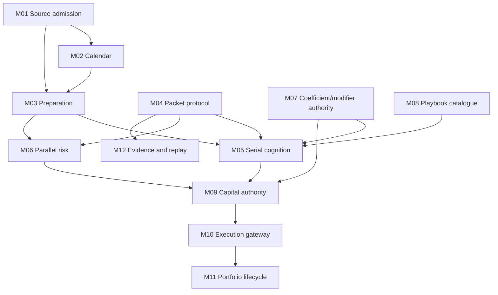

# Atlas integration architecture and codebase decision

Original analysis date: 20 July 2026
Control integration date: 25 July 2026
Scope: target architecture, ownership, dependency and implementation-control authority; no production source or test mutation
Decision status: **formally accepted by the user with the amendments recorded in this report**

## Executive decision

Adopt a **controlled module-by-module replacement/refactor inside the governed modular monolith**. Do not perform a big-bang clean rewrite, and do not preserve the alpha implementation wholesale.

The evidence supports that middle course:

- all eighteen governed architecture surfaces are currently classified `thin_seam`, not `implemented` (`docs/11.1_NATIVE_ARCHITECTURE_BLUEPRINT_WORKING.md:39-66`; `project_control/normative_authority_top_down_alignment/IMPLEMENTATION_TRUTH_LEDGER.tsv:2-19`);
- the package nevertheless records 1,105 passing existing Tier A tests and 49 passing Tier B tests, so locally useful behaviour exists and should not be discarded without cause (`GATE_D_READINESS_REPORT.md:34-45`);
- 131 of 287 Atlas cohorts are explicitly `split` and 11 are `merged`, proving that cohort-to-module allocation is many-to-many rather than file-shaped;
- at record level, 494 donor items are rejected as plumbing and 94 as contradictory, while 288 are retained and 380 strengthen current behaviour. A mechanical port would therefore import both useful intent and known rubbish with admirable impartiality;
- the largest structural defects are concentrated in composition, identity/lineage, prepared-data typing, state/transactions, final-risk joining and authoritative replay. Those seams should be replaced cleanly behind stable contracts, while separable deterministic algorithms and their truthful tests are retained or refactored.

The target is sixteen coherent capabilities covering the eighteen canonical surfaces. It is **not** 287 modules, eighteen microservices, or a speculative plugin platform. The current architecture explicitly keeps the modular monolith and rejects premature distributed machinery (`docs/11.1_NATIVE_ARCHITECTURE_BLUEPRINT_WORKING.md:70-87,157`).

## 1. Authority and decision rules

This analysis applies the supplied hierarchy without treating existing code as truth:

1. the user's current instruction and admitted official-source decisions;
2. project control and normative documents;
3. admitted Tier A, Tier B and Tier C proof according to their tier law;
4. implementation as observed evidence only;
5. Atlas as candidate behavioural/functional evidence, never as an automatic new requirement.

The repository itself says doctrine governs tests and code (`docs/01_NORMATIVE_CORE.md:5-17,19-33`), and that external practice becomes project authority only after project-specific admission (`project_control/normative_authority_top_down_alignment/EXEC_PLAN.md:11-33`). No new external proposition was invented in this phase because the target architecture and nine completion packages were already frozen.

The current runtime remains deterministic and non-agentic (`docs/01_NORMATIVE_CORE.md:21-27`). The fourteen governed runtime steps and six-stage serial spine remain intact (`docs/01_NORMATIVE_CORE.md:35-69`). Parallel Risk remains a separate lane and does not form the candidate or allocate capital (`docs/01_NORMATIVE_CORE.md:71-80`).

## 2. Unified inventory

| Archive | SHA-256 | Compressed | Entries | Files | Dirs | Links | Git baseline |
| --- | --- | --- | --- | --- | --- | --- | --- |
| Atlas | `d7c5d034f53108bf50cc0d383d1dafce894100f377414c6e132fd9b0bb2cf711` | 27,984,440 B | 3,352 | 2,848 | 504 | 0 | `worker/atlas-semantic-reconciliation` @ `91e2d620e8b4` (clean) |
| Governed | `5a75fb237232d9b6a8bc804a81c6bc62c9ad7a719fee57346d632b39a060857c` | 33,767,497 B | 8,803 | 8,299 | 504 | 0 | `work/NVIDIA_2026_normative_authority_top_down_alignment_20260717` @ `f7bd3f46862f` (clean) |

The detailed workbook contains every tar member with path, entry type, bytes, category and evidence role. Important active-package counts in the governed archive are:

- 64 files under `docs`, 203 under `tests`, 208 under `src`, 11 under `config`, 148 under `project_control`, 132 under `intent_migration`, and 158 under `legacy_import`;
- 166 Tier A Python test files containing 631 literal `test_` definitions, 13 Tier B files containing 49 literal definitions, and no active Tier C pytest files. Parametrisation explains why the packaged run reports 1,105 Tier A cases rather than 631 definitions;
- the Atlas package contains 1,716 resolved record sidecars and 287 cohorts, with exact record-to-source-file/line/hash lineage.

The archives were integrity-checked before extraction and their Git worktrees remain clean. Archive hashes appear above and in the workbook.

### Inventory separation

The two packages contain overlapping historical snapshots, but they have different evidentiary roles:

- Atlas `02_NORMATIVE`, `03_TEST_AUTHORITY` and `04_NATIVE_IMPLEMENTATION` are the snapshot against which the 287 cohort decisions were made;
- the governed archive's current `docs`, `tests`, `src`, `config` and `project_control` are the live decision baseline;
- `legacy_import` and Atlas donor inputs are historical/candidate evidence, not native authority;
- `.git` objects and recovery bundles are inventoried but excluded from semantic counts.

## 3. Atlas traceability and current-authority rebase

| Atlas cohort state | Count | Architectural consequence |
| --- | --- | --- |
| confirmed | 113 | usable candidate intent after current-authority rebase |
| split | 131 | must be distributed; one cohort must not become one module |
| merged | 11 | must be absorbed into shared abstractions |
| provisional | 3 | requires explicit normative admission |
| rejected | 29 | trace retained; no target-runtime obligation |

| Atlas record disposition | Count |
| --- | --- |
| admit_new_normative_intent | 152 |
| merge_with_existing_concept | 127 |
| reject_contradictory | 94 |
| reject_donor_plumbing | 494 |
| retain_existing_native | 288 |
| split_across_native_concepts | 181 |
| strengthen_existing_native | 380 |

The workbook provides two linked traces:

- `Cohort Trace`: one row for every cohort, including all member IDs, semantic statement, invariants, uncertainty, historical Atlas labels, canonical 5.1–5.18 surfaces, target modules, current C-requirements, current Gate D units, Atlas norm/test/code references, rebase state and proposed architectural treatment;
- `Record Trace`: one row for every original Atlas record, including packet, source file and exact line interval, record hash, primary cohort, disposition, native equivalence, canonical surface and target module.

That pair proves both directions: original record → cohort → governed surface/module, and target module → its contributing cohorts/records.

### Reference rebase result

| Reference rebase state | Unique references | Treatment |
| --- | --- | --- |
| unchanged_since_atlas_snapshot | 265 | direct current path still matches bytes |
| changed_rebase_required | 2 | reread current file before relying on cohort conclusion |
| directory_reference_present | 9 | directory-level evidence only; narrow before implementation |
| unresolved_reference | 23 | stale/nonexistent historical reference; block direct implementation claim |

The two byte-changed referenced files are `docs/07.1_RUNTIME_OWNERSHIP_AND_CONSUMER_LEDGER_WORKING.md` and `src/nvda_desk/vocabulary_synonym_audit.py`. The 23 unresolved references are retained explicitly rather than silently guessed; most point to historical paths that exist in neither the Atlas snapshot nor the governed baseline. An affected cohort may not use such a reference as implementation proof until it is narrowed or replaced.

The current governed package also adds five authority documents not present in the older Atlas snapshot: `docs/02.2_SIGNAL_INFORMED_INTRADAY_PHASE_WORKING.md`, `03.2_INPUT_AND_CALENDAR_DOMAIN_WORKING.md`, `04.2_PREPARED_DATA_CONTRACTS_WORKING.md`, `07.2_STATE_RISK_AND_REPLAY_WORKING.md`, and `11.1_NATIVE_ARCHITECTURE_BLUEPRINT_WORKING.md`. These supersede any stale Atlas-era conclusion within their bounded scope.

### Cohort distribution by current surface

| Surface | Cohorts | Target module(s) | Current truth | Principal limitation |
| --- | --- | --- | --- | --- |
| 5.1 External source interfaces and API ingress | 20 | M00;M01 | thin_seam | API composition mixes unrelated mapping/state responsibilities; provider substitution not proved |
| 5.2 Raw capture and source temporal law | 29 | M01 | thin_seam | No authoritative durable raw capture or complete replay evidence |
| 5.3 Raw signal families | 37 | M01 | thin_seam | Extension and complete upstream composition not proved |
| 5.4 Financial and event calendar architecture | 45 | M02 | thin_seam | Provider substitution and complete runtime composition not proved |
| 5.5 Prepared ingress and runtime context preparation | 48 | M03 | thin_seam | All required source families not composed into one governed run |
| 5.6 DMPV3 packet carriage | 31 | M04 | thin_seam | Identity lineage validation and replay obligations incomplete |
| 5.7 Serial desk-cognition spine | 92 | M05 | thin_seam | Not complete governed sequence; missing lanes must not be bridged |
| 5.8 Parallel risk lane | 40 | M06 | thin_seam | Process-global state and incomplete composition remain |
| 5.9 Dynamic coefficient and modifier authority | 51 | M07 | thin_seam | Material version carriage and consumer integration incomplete |
| 5.10 Playbook library architecture | 29 | M08 | thin_seam | Replaceability and governed composition not proved |
| 5.11 Downstream capital deployment authority | 43 | M09 | thin_seam | Capital state process-memory only; no operational deployment authority |
| 5.12 Opening architecture and placement readiness | 26 | M10 | thin_seam | No binding placement/broker operation; lineage incomplete |
| 5.13 Live position and inventory architecture | 32 | M11 | thin_seam | Material state process-memory only |
| 5.14 Exit and close architecture | 33 | M11 | thin_seam | Outputs not operational or fully lineage-safe |
| 5.15 Review and explanation layer | 69 | M12 | thin_seam | Complete preserved evidence and end-to-end replay not established |
| 5.16 Persistence ledgers and receipts | 102 | M13 | thin_seam | Most material state remains process memory |
| 5.17 Testing proof and checkpoint surfaces | 125 | M14 | thin_seam | Environment closure isolation aggregate promotion and architecture proof incomplete |
| 5.18 Vocabulary governance interface | 52 | M15 | thin_seam | Semantic registry/projection parity and isolated clean proof incomplete |

Counts overlap because cross-cutting cohorts legitimately map to several surfaces. That is the intended many-to-many model, not double-counting.

## 4. Target modular architecture

| ID | Target capability | Surfaces | Owns | Primary change |
| --- | --- | --- | --- | --- |
| M00 | application_shell | 5.1 | HTTP/CLI translation, dependency composition, run lifecycle; no business truth | replace composition root; preserve endpoint intent only where governed |
| M01 | source_admission | 5.1;5.2;5.3 | source identity, offline admission, raw capture, source time, raw-signal family registry | refactor around one authoritative ingress; replace identity/capture gaps |
| M02 | calendar | 5.4 | four semantic calendar layers, candidate coalescence, supersession and runtime projection | retain reference algorithms; replace split operational/reference truth |
| M03 | preparation | 5.5 | typed prepared envelope, field-candidate resolution and enrichment gaps | replace generic mapping core; retain bounded deterministic transforms |
| M04 | packet_protocol | 5.6 | DMPV3 envelope validation and packet carriage only | retain envelope shape; replace fabricated identity/time defaults |
| M05 | serial_cognition | 5.7 | six ordered candidate-forming stages and stage-local carriers | retain stage order/local algorithms; replace orchestrator and implicit construction |
| M06 | parallel_risk | 5.8 | independent environmental risk lane and final-risk contribution | retain bounded evaluation; replace incomplete/global composition |
| M07 | coefficient_modifier_authority | 5.9 | versioned coefficients, modifiers, precedence and application receipts | refactor version carriage and consumer integration |
| M08 | playbook_catalogue | 5.10 | playbook definitions, replaceable registry and eligibility semantics | refactor behind replaceable catalogue contract |
| M09 | capital_authority | 5.11 | pre-deployment gate, bounded sizing and fresh-capital decision | retain bounded calculations; refactor state and final-risk join |
| M10 | execution_gateway | 5.12 | opening readiness, placement intent, broker protocol and execution receipts | use alpha behaviour as reference; replace boundary before operational use |
| M11 | portfolio_lifecycle | 5.13;5.14 | live inventory, position state, exit/close and carry lifecycle | retain decision kernels; replace process-memory state ownership |
| M12 | evidence_replay | 5.15 | review projections, explanation, counterfactual comparison and authoritative replay | retain read-only projections; replace replay packaging/completeness core |
| M13 | state_kernel | 5.16 | transaction boundary, idempotency, atomic receipts and storage ports | replace in-memory kernel; retain local duplicate/copy invariants as tests |
| M14 | proof_promotion | 5.17 | proof manifests, tier classification, checkpoints and promotion receipts | retain framework; refactor incomplete environment/aggregate proof |
| M15 | vocabulary_governance | 5.18 | durable term admission, canonical registry and generated projections | refactor and reconcile human/generated parity |

### Architectural laws

1. **One modular monolith, explicit internal ports.** Package boundaries express ownership; they do not imply network calls.
2. **One common DMPV3 outer envelope, strongly typed payloads.** The normative architecture requires a common envelope without merging responsibility (`docs/04_TECHNICAL_ARCHITECTURE_CORE.md:24-50`).
3. **Owner-issued identity only.** Source IDs, capture IDs, packet IDs, transaction IDs and domain IDs are distinct. They cannot be fabricated from one another (`docs/03.2_INPUT_AND_CALENDAR_DOMAIN_WORKING.md:28-40,129`).
4. **Module-owned data, shared transaction mechanism.** M13 owns atomicity, idempotency and the transaction journal; it does not become the semantic owner of calendar, capital, portfolio or evidence records. State plus its attesting receipt becomes visible atomically (`docs/07.2_STATE_RISK_AND_REPLAY_WORKING.md:17-76`).
5. **Run-scoped composition.** M00 translates transport requests and supplies explicit dependencies. It holds no business collections, policy defaults or private repository state.
6. **Serial and parallel risk stay separate until K11.** Both branches are independently mandatory and join only before capital authority (`docs/07.2_STATE_RISK_AND_REPLAY_WORKING.md:78-143`).
7. **Review is read-only and evidence-backed.** M12 cannot repair missing lineage, mutate decisions or call comparison-only behaviour “authoritative replay.”
8. **Mandatory gaps fail closed; optional gaps remain explicit.** Typed preparation must withhold authoritative output when mandatory identity, versions, fingerprints or transformations fail (`docs/04.2_PREPARED_DATA_CONTRACTS_WORKING.md:40-87,120`).
9. **Extension occurs at observed volatility points.** Source providers, signal families, enrichments, playbooks, policies, storage adapters and execution adapters have explicit ports. No generic plugin loader is introduced.
10. **Every boundary has isolated proof.** Producer, consumer, invalid/degraded state, numeric integrity, omission/null semantics and checkpoint evidence apply where relevant (`docs/08_TESTING_AND_PROMOTION_CORE.md:29-101,135-169`).

### Accepted dependency planes

The original workbook's `Hard Dependencies` field mixed runtime calls, transaction participation and governance prerequisites. Formal acceptance separates them.

For accepted plane-specific edges, arrows run from provider/prerequisite to consumer/dependent. Historical `D-xxx` dependency rows retain their original dependent-to-prerequisite convention and remain historical planning evidence only.

#### Runtime and contract graph

In the human-readable flow below, arrows run from prerequisite/provider to dependent/consumer. In the machine-readable dependency table, `source_id` is the dependent and `target_id` is its prerequisite.

`M00` is omitted because it composes the runtime and must not become a domain dependency. `M13` is a transaction mechanism rather than owner of all domain records. `M14` and `M15` are governance-plane prerequisites, not universal production imports.

#### State and transaction participation

`M01`, `M02`, `M06`, `M09`, `M10`, `M11` and `M12` may participate in `M13` transactions where their accepted module behaviour mutates state and a receipt. Their domain records remain owned by those modules.

#### Governance and promotion

`M00`–`M13` require `M14` proof and `M15` vocabulary acceptance before promotion. `M14` is governed by `M15`. Build/test tooling remains a fourth, development-only dependency plane.

The accepted runtime graph is acyclic. The current Python package graph nevertheless contains two small cycles, `contracts ↔ packets` and `cognition ↔ domain`, to be eliminated during progressive module migration.

### Poorly separated current responsibilities

| Current tangle | Evidence | Target separation |
|---|---|---|
| API shell as composition, mapping and mutable-state owner | `src/nvda_desk/api/app.py:51-86,228-236,278-304`; cached mutable dependencies in `api/deps.py:67-180` | M00 translation only; run-scoped ports; domain state behind its owner and M13 |
| Prepared data as generic dictionary with fixed precedence | `preparation/runtime_preparer.py:27-72,324-377`; current norm explicitly calls identity optional and dictionaries non-conforming (`docs/04.2...:87`) | K05 typed envelope plus K06 field-resolution receipt |
| Packet protocol owns clocks and default authority IDs | `contracts/packets.py:127-190` | M04 validates supplied owner facts; clock/identity originates at run and domain owners |
| Orchestrator owns service construction, identity and packet emission | `runtime/orchestrator.py:33-73,80-187` | M00 composes; M05 orders stages; M04 carries packets; identity context is injected |
| Parallel risk is only partly composed | `risk/parallel/evaluate.py:93-132`; current norm records serial-only final-risk helpers (`docs/07.2...:141`) | M06 completes its independent lane; K11 performs the only serial/parallel join |
| Persistence is mostly process memory | `persistence/session_factory.py:1-19`; `receipt_ledger.py:10-62`; implementation truth surface 5.16 | M13 atomic UnitOfWork/idempotency; module-owned repository ports; durable adapter selected later |

These are responsibility cycles/tangles, not a claim of Python import cycles. The original combined-dependency graph and the historical D-unit dependency graph validate as acyclic mechanically. The accepted architecture now uses the separated runtime/contract graph for dependency readiness and retains governance relationships outside that runtime graph.

## 5. Retain, refactor or rewrite assessment

### Recommendation

Use **selective clean replacement at the central seams, with retention/refactoring of proven local kernels**:

- replace M00 composition, M03's generic prepared-data core, permissive M04 construction, the M05 orchestrator, M06 composition, M13 transaction/state core, final-risk join and authoritative replay core;
- retain and refactor bounded deterministic source/calendar transforms, raw-signal carriers, serial stage order, stage-local classifiers, risk evaluation checks, coefficient/playbook loaders, capital calculations, lifecycle decision kernels, review projections and proof tooling;
- keep rejected or compatibility-only Atlas material as trace evidence, not runtime code;
- do not preserve a file merely because a passing test touches it. Preserve the governed invariant, then choose the cleanest owner and interface.

This is effectively a clean rebuild of the **architecture spine**, not a clean rewrite of every behaviour.

### Decision distribution

| Decision class | Components |
| --- | --- |
| behavioural_reference_then_replace | 1 |
| refactor | 6 |
| refactor_or_replace | 1 |
| replace | 3 |
| replace_boundary | 1 |
| replace_core | 3 |
| replace_state_boundary | 1 |
| replace_state_refactor_domain | 1 |
| retain | 4 |
| retain_and_reconcile | 1 |
| retain_and_refactor | 8 |
| retain_as_behavioural_kernel | 1 |
| retain_shape_replace_construction | 1 |

### Highest-risk components

| Component | Decision | Evidence | Target action |
| --- | --- | --- | --- |
| Operational calendar repositories/API | replace_state_boundary | process-memory split truth, weak duplicate law and mixed API ownership | unify under M02-owned repository ports and M13 transactions |
| Prepared runtime data model | replace_core | generic payload dictionaries, optional identity and fixed precedence lose field provenance | implement K05/K06; salvage deterministic feature functions only |
| DMP envelope model | retain_shape_replace_construction | common typed envelope exists; builder invents time/trace/run/scenario defaults | make role-specific IDs/times mandatory and validate owner provenance |
| Runtime orchestrator | replace | constructs services inline, derives authority IDs and omits full governed lanes/join | new application runner composed from explicit ports and contracts |
| Parallel-risk composition | replace | partial temporal bootstrap and process-global cached services | run-scoped service with explicit M13 observation repository |
| Capital contracts/calculations | retain_and_refactor | bounded calculations/contracts exist; state and final-risk join are incomplete | preserve pure calculations; rebuild M09 state/join boundary |
| Opening and paper broker code | behavioural_reference_then_replace | surface is provisional and no binding broker authority is established | define K15 first; re-admit only proven paper adapter behaviour |
| Inventory/position repositories | replace_state_refactor_domain | duplicate/copy invariants exist but material state is process memory | keep domain invariants; replace backing and transaction participation |
| Replay core | replace_core | no authoritative end-to-end preserved envelope or executable packaging | implement K19 from M13 receipts and version manifests |
| Persistence session and repositories | replace_core | dict-backed sessions and mostly process-memory material state cannot satisfy N-06/N-09 | M13 UnitOfWork, idempotency and atomic receipt contract |
| HTTP application shell/dependencies | replace | one shell composes unrelated services, accesses private state and caches mutable repositories | thin M00 translation/composition root with run-scoped dependencies |

The complete component matrix in the workbook includes 32 assessed groups with evidence, target action and migration risk.

### Why not a big-bang rewrite?

- It would discard 288 Atlas records explicitly assessed as native-retain, 380 assessed as strengthen-existing, and a substantial passing proof base.
- It would increase migration risk across several semantics that are locally correct but poorly composed.
- The normative target is a modular monolith with stable substitution boundaries, not an excuse to restart every pure function.

### Why not an in-place blanket refactor?

- The current composition and state boundaries contradict the new N-03, N-04, N-06, N-08 and N-09 requirements structurally.
- Fixing those through incremental flags/defaults would preserve fabricated identity, generic payload and process-global assumptions in the new core.
- Every surface is `thin_seam`; there is no evidence-backed basis for declaring the existing architecture largely complete.

## 6. Accepted implementation-control sequence

The 33 `D-xxx` records remain immutable traceability obligations. They preserve requirement, proof, source and dependency history, but they are not packages, mandatory branches or a numeric total order.

Implementation is organised by accepted Ownership Module. Relevant `D-xxx` records are regrouped beneath that module and may be retained, expanded, split, merged, replaced with lineage preserved, or retired with reason.

### Mandatory positive obligations beyond the historical set

The 33 records do not by themselves provide complete positive implementation coverage for:

- `M07`: coefficient/modifier bundles, precedence, version identity, stage ownership and application receipts;
- `M09`: capital state, bounded sizing, fresh-capital decision and deployment receipt in addition to the final-risk join;
- `M10`: alpha execution port, paper adapter, placement intent, order/fill events and execution receipt, with no live-execution authority;
- `M11`: fill reconciliation, canonical position/inventory state and atomic lifecycle receipts.

These are mandatory module obligations. No new `D` identifier is silently invented by this control integration.

### Module-local proof gate

Before source mutation for one bounded module behaviour:

1. freeze the owner, behaviour, prohibited authority and dependencies;
2. establish sufficient normative and vocabulary meaning;
3. identify only tests plausibly governing that behaviour;
4. independently adjudicate exact test-to-proposition relationships;
5. specify and implement truthful proof, expected red where behaviour is absent;
6. issue an explicit implementation-opening decision;
7. implement within the active module only;
8. run targeted authoritative proof and the complete legacy suite as shadow evidence;
9. checkpoint before another module opens.

Unrelated unreviewed tests retain `LEGACY_SHADOW_UNADMITTED`: visible and runnable, but not authority for the active module. The eleven historically closed proof units attach to their owning modules and must be resolved before those behaviours open.

### Progressive physical migration

Target packages use `src/nvda_desk/mxx_module_name/` and are created only when the module becomes active. There is no repository-wide package move. Temporary compatibility adapters must point toward the accepted owner and receive no new domain behaviour.

### Default serial programme

`M14 proof_promotion` and `M15 vocabulary_governance` operate continuously as governance capabilities. Code work remains one module at a time in this dependency-ready order:

1. `M13 state_kernel`;
2. `M01 source_admission`;
3. `M02 calendar`;
4. `M03 preparation`;
5. `M04 packet_protocol`;
6. `M07 coefficient_modifier_authority`;
7. `M08 playbook_catalogue`;
8. `M05 serial_cognition`;
9. `M06 parallel_risk`;
10. `M09 capital_authority`;
11. `M10 execution_gateway`;
12. `M11 portfolio_lifecycle`;
13. `M12 evidence_replay`;
14. `M00 application_shell` final composition.

`M05` and `M06` may be reversed after their prerequisites are accepted. Any other order change requires a recorded dependency decision before work begins.

The first planned source module is the deliberately narrow `M13` alpha transaction foundation: `UnitOfWork`, idempotency key and input fingerprint, atomic state-plus-receipt commit, rollback without success receipt and an in-memory adapter. It does not establish production durability, HA, backup or recovery.

## 7. Explicit unknowns and stop conditions

Do not infer or implement:

- production retention periods, storage topology, RTO/RPO, high availability, deployment, capacity or recovery;
- live brokerage, credentials or real-money execution;
- N-07 numeric thresholds, dwell/grace windows or calibration without versioned configuration authority;
- production authoritative-replay packaging/storage that is still Unknown;
- any of the 23 unresolved Atlas references as if they were current evidence;
- vocabulary or behavioural completeness beyond the 124 human-registry records deterministically projected during this control integration; registry parity does not prove runtime implementation.

Root `PLANS.md`, `ROADMAP_LEDGER_V2.md`, the canonical ExecPlan and the module-local proof protocol are now the active execution controls. Historical plans, readiness labels and fixed-order projections remain evidence only.

## 8. Validation and limitations

| Validation | Expected | Actual | Result |
| --- | --- | --- | --- |
| Atlas cohort count | 287 | 287 | PASS |
| Atlas record sidecar count | 1716 | 1716 | PASS |
| Unique record IDs | 1716 | 1716 | PASS |
| All sidecars linked to a primary cohort | 1716 | 1716 | PASS |
| Every sidecar represented by cohort primary/supporting union | 1716 | 1716 | PASS |
| Historical labels normalised | 0 | 0 | PASS |
| Current surfaces represented | 18 | 18 | PASS |
| Every surface has target module allocation | 18 | 18 | PASS |
| Accepted ownership modules | 16 | 16 | PASS |
| Historical `D-xxx` work-unit count preserved | 33 | 33 | PASS |
| Mandatory positive module obligations | 4 | 4 | PASS |
| Accepted runtime/contract module graph is acyclic | True | True | PASS |
| Governance edges separated from runtime | True | True | PASS |
| State/transaction participation separated | True | True | PASS |
| Historical D-unit dependency graph remains traceable | True | True | PASS |
| Vocabulary human/generated registry parity | 124 / 124 | 124 / 124 | PASS |
| Source archives unchanged (hash recorded) | 2 | 2 | PASS |

Additional limits:

- the Atlas validator was rerun and passed record/cohort/cross-ledger checks, but its optional full JSON-Schema branches were skipped because `jsonschema` was unavailable. The supplied return receipt remains the evidence for its earlier full validation;
- automated work was limited to inventory, hashing, label normalisation, cross-reference resolution and table/graph construction. It did not promote Atlas semantics or decide current authority;
- candidate current N-package associations in the cohort matrix are architecture-level routing aids and require row-level confirmation before a code unit is opened.

## 9. Formal acceptance and next checkpoint

The user formally accepted the architecture review on 25 July 2026 with these amendments:

1. `M00`–`M15` are the target Ownership Modules;
2. `M07` is narrowed and named `coefficient_modifier_authority`;
3. dependency planes are separated;
4. physical packages migrate progressively;
5. 33 `D-xxx` records remain traceability obligations rather than a fixed execution order;
6. missing positive obligations for `M07`, `M09`, `M10` and `M11` are mandatory;
7. Gate C operates locally per module, with final global reconciliation before whole-system claims;
8. `M13` is the first planned implementation module after control integration.
9. seven durable architecture/proof control terms are admitted in the human vocabulary registry and projected through the unchanged deterministic builder.

This report's formal acceptance establishes target ownership and execution control. It does not declare any module implemented or open production source mutation on the control-integration branch.

The next checkpoint is consistency validation of all governing controls and Atlas artefacts, followed by an immutable branch archive. Only after that integration is accepted on `main` may the separate `M13` module-local proof gate begin.
